# Практичне заняття 2. Проектування мереж Modbus RTU

## Основні теоретичні відомості

### Особливості проектування мереж Modbus RTU

Варто виділити наступні основні особливості, які треба враховувати в мережах Modbus RTU/ASCII:

- Модель доступу до шини: Ведучий–Ведений (Master–Slave) — лише ведучий ініціює обмін, решта пристроїв лише відповідають. Це потребує явного визначення одного пристрою як ведучого (наприклад, ПЛК або SCADA).
- Один обмін — один запит, одна відповідь — не допускається мовчазний обмін між двома веденими пристроями без участі ведучого.
- Адресація пристроїв: допустимий діапазон — 1…247 (0 зарезервовано для широкомовної передачі), всі адреси мають бути унікальними.
- Формат кадру — залежить від варіанта протоколу, усі пристрої на шині мають підтримувати однаковий формат:
  - RTU: двійковий формат, менший об’єм даних, суворіші вимоги до таймінгів (3.5 символів тиші між кадрами).
  - ASCII: текстовий формат, зручніший для ручного зчитування, проте менш ефективний.
- Однакова швидкість (baudrate) для всіх пристроїв на шині, типові значення: 9600, 19200, 38400 біт/с.
- Одна фізична лінія — одна сесія обміну. Відсутність підтримки кількох одночасних з’єднань або обробки кількох запитів.
- Відсутність автоматичного виявлення пристроїв — конфігурація має проводитись вручну (адреси, швидкість, паритет, стоп-біти).
- Обмеження кількості вузлів — типово до 32 без репітерів (залежить від драйверів та рівня сигналу, можливе розширення з повторювачами до 247).
- Підтримка стандартних функцій Modbus - кожен пристрій може підтримувати різний набір функцій, це треба враховувати при проектуванні.
- Час очікування відповіді — якщо ведучий не отримує відповідь у визначений час, це вважається помилкою (timeout).
- Очікування відповіді від відсутнього в мережі пристрої сильно впливає на обмін. 

Ці особливості мають прямий вплив на архітектуру обміну, вибір пристроїв та логіку керування, тому їх слід враховувати вже на етапі проектування. 

### Типові кроки проектування мережі Modbus

Проектні рішення щодо мережі Modbus можуть проходити в наступні кроки:

1) Визначення вузлів з призначенням Client та Server, відповідно з призначенням Мaster (Ведучий) та Slave(Ведений).
2) Підібрати апаратні засоби у відповідності до апаратних можливостей комп'ютерів (PC), ПЛК (PLC), операторських панелей (OP), перетворювачів частоти (ATV) та інших мережних засобів.
3) У випадку неможливості з'єднання змінити частину апаратних та (або) програмних засобів.
4) Згрупувати дані для мережного обміну.
5) Підібрати сервіси для реалізації інформаційних потоків.
6) Підрахувати кількість запитів за 1с.

Враховуючи функціонування протоколу прикладного рівня по моделі Клієнт/Сервер обміну повідомленнями, в блоці 1 необхідно визначити вузли, які повинні ініціювати обмін. Серед типів програмно-технічних засобів типовими ініціаторами обміну можуть бути:

-     засоби людино машинного інтерфейсу (HMI), до яких відносяться ОП та комп’ютери зі SCADA/HMI;

-     контролери, яким необхідно доступатись до інших контролерів або до периферійних засобів;

-     програматори або конфігуратори

Засоби HMI обмінюються даними з контролерами, периферійними засобами або іншими засобами HMI. Для відображення плинних даних процесу, засоби HMI опитують їх значення з певною періодичністю тільки тоді, коли сторінка відображення є активною. Така поведінка є логічною, оскільки економляться часові ресурси мережі. Однак деякі засоби HMI дають можливість постійного опитування даних. Зокрема це характерно для операцій ведення архівів а також для задач тривог та аварій. Запис даних процесу з HMI проводиться як правило тільки при їх зміні. Тому логічним є те, що засоби HMI в мережі повинні бути Клієнтами. Виключенням можуть бути ситуації, коли в мережі повинно бути декілька засобів HMI, або коли є необхідність в передачі термінових повідомлень на термінал. Ці ситуації розглянуті нижче.

При необхідності обміну даними контролера з іншим контролером, або з периферійними засобами, він повинен ініціювати обмін, тобто бути Клієнтом. 

Програматори та конфігуратори теж повинні бути Клієнтами. В зв’язку з тим, що підключення їх до мережі проводиться тільки при необхідності, та при умові відсутності вимог до одночасного функціонування мережі разом зі зміною конфігурації/програми мережних вузлів, можна вважати, що програматор не входить в структуру мережі. В іншому випадку, необхідно виділяти окремий канал, тобто виділяти окрему мережу для пристроїв, які необхідно програмувати, якщо таке можливе.  

У будь якому випадку, кількість клієнтських вузлів не може бути більше одного, оскільки прикладний процес Клієнта в одній мережі MODBUS RTU може знаходитись тільки на Ведучому. Якщо кількість Клієнтів все ж таки більше одного можна спробувати перенести клієнтські запити вузлів на один вузол з правами Ведучого.  Якщо перенос не вдається по певним причинам необхідно на вузлах виділити окремі канали, тобто замість одної мережі створити декілька мереж, якщо таке можливо, або змінити забезпечення вузлів.       

Якщо Клієнт тільки один, його прикладний Процес буде виконуватися на вузлі з правами Ведучого шини. Після всіх проведених вище перевірок, необхідно узгодити фізичні інтерфейси та при необхідності використати адаптери перетворювачі. При великих довжинах ліній необхідно підібрати репітер, після чого визначитися з кінцевою структурою, бітовим швидкостям та перевірити відповідність фізичних характеристик вимогам MODBUS RTU. 

При наявності часових комунікаційних характеристик для портів всіх засобів, які приймають участь в обміні, бажано розрахувати орієнтований час обміну. Якщо час обміну задовольняє, то мережа підходить для вирішення поставлених задач і можна переходити до розробки схем та інших документів.

При проєктуванні мережі Modbus RTU важливо перевірити, які саме функції протоколу підтримуються кожним із пристроїв (PLC, HMI, ATV тощо). Хоча Modbus є відкритим і стандартизованим протоколом, реалізація на практиці значно відрізняється залежно від виробника і навіть конкретної моделі пристрою. Не всі пристрої підтримують однаковий набір функцій (function codes), типи адресації чи формати даних. Для контролерів потрібно перевірити, чи підтримується:

- функція читання Holding Registers (код 03),
- функція читання Discrete Inputs (код 02),
- функція запису одного/декількох регістрів (коди 06, 16),
- чи можна налаштувати поведінку як Master або Slave,
- доступ до Modbus через вбудований порт або зовнішній комунікаційний модуль.

Для HMI-панелей або SCADA слід з’ясувати:

- як налаштовується періодичність опитування,
- як реалізовано обробку тайм-аутів і помилок CRC,
- чи є обмеження на кількість тегів у одному запиті.

Особливої уваги потребує ситуація, коли планується обмін між різними виробниками (наприклад, VIPA ↔ Schneider). У таких випадках важливо звірити специфікації щодо:

- формату адрес (0-based чи 1-based),
- порядку байтів (Big/Little Endian),
- типів даних (16-біт, 32-біт float),
- обробки негативних значень.

Уся ця інформація зазвичай подається в технічній документації до пристрою або у Modbus Mapping Tables. Її необхідно вивчити до початку фізичного з’єднання, оскільки несумісність може призвести до помилок, які важко діагностуються. У разі сумнівів рекомендується протестувати обмін з використанням емуляторів або Modbus-моніторів.

## Завдання для самостійної роботи

1) Підібрати апаратні та програмні засоби для реалізації поставленої задачі у вигляді блочної моделі інформаційних потоків (рис.2.1-27) з використанням технічних засобів, які наведені в табл.2.1(а)-2.27(а). Орієнтовні відстані між засобами наведені в табл.2.1(б) - 2.27(б).
2) Побудувати схему КТС та схему з’єднань проводок мереж у вигляді ескізних схем. Навести відомість мережних засобів. 
3) Побудувати інформаційну структуру з використанням будь яких графічних редакторів або від руки. До схеми навести перелік умовних позначень

### Варіант №1

Таблиця.2.1(а)

| PC1  | PC2  | PLC1    | PLC2 |
| ---- | ---- | ------- | ---- |
| -    | -    | VIPA200 | M241 |

Таблиця.2.1(б)

|      | PC1  | PC2  | PLC1 | PLC2 |
| ---- | ---- | ---- | ---- | ---- |
| PC1  | -    | 200м | 10м  | 200м |
| PC2  |      | -    | 200м | 10м  |
| PLC1 |      |      | -    | 200м |
| PLC2 |      |      |      | -    |

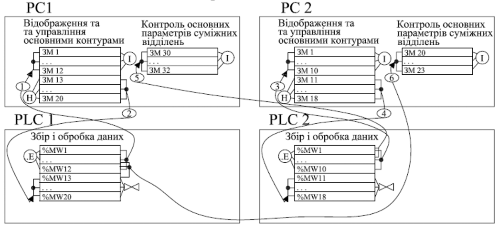

рис.2.1.

### Варіант №2

Таблиця.2.2(а)

| PC   | OP   | PLC1 | PLC2 |
| ---- | ---- | ---- | ---- |
| -    | -    | M221 | M241 |

Таблиця.2.12(б)

|      | PC   | OP   | PLC1 | PLC2 |
| ---- | ---- | ---- | ---- | ---- |
| PC   |      | 200  | 200  | 200  |
| OP   |      |      | 200  | 1    |
| PLC1 |      |      |      | 200  |
| PLC2 |      |      |      |      |

рис.2.2.

### Варіант №3

Таблиця.2.3(а)

| PC   | PLC1    | PLC2    | ATV  |
| ---- | ------- | ------- | ---- |
| -    | S7-1200 | VIPA200 |      |

Таблиця.2.3(б)

|      | PC   | PLC1 | PLC2 | ATV  |
| ---- | ---- | ---- | ---- | ---- |
| PC   |      | 10   | 10   | 200  |
| PLC1 |      |      | 10   | 200  |
| PLC2 |      |      |      | 200  |
| ATV  |      |      |      |      |

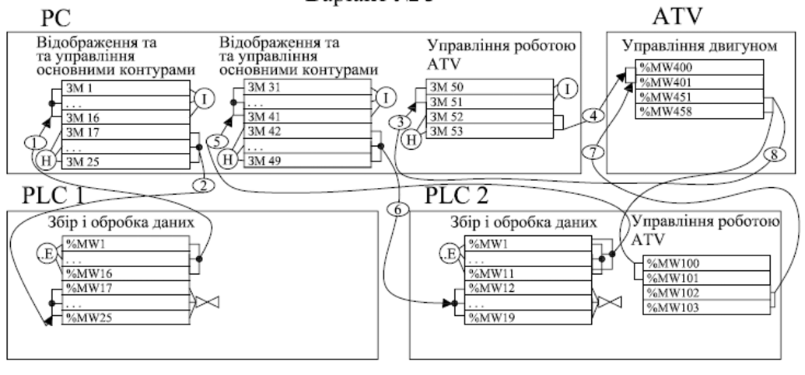

рис.2.3.

### Варіант №4

Таблиця.2.4(а)

| OP   | ATV  | PLC1 | PLC2 |
| ---- | ---- | ---- | ---- |
| -    | -    | M221 | M221 |

Таблиця.2.4(б)

|      | OP   | ATV  | PLC1 | PLC2 |
| ---- | ---- | ---- | ---- | ---- |
| OP   |      | 200  | 200  | 1    |
| ATV  |      |      | 200  | 200  |
| PLC1 |      |      |      | 200  |
| PLC2 |      |      |      |      |

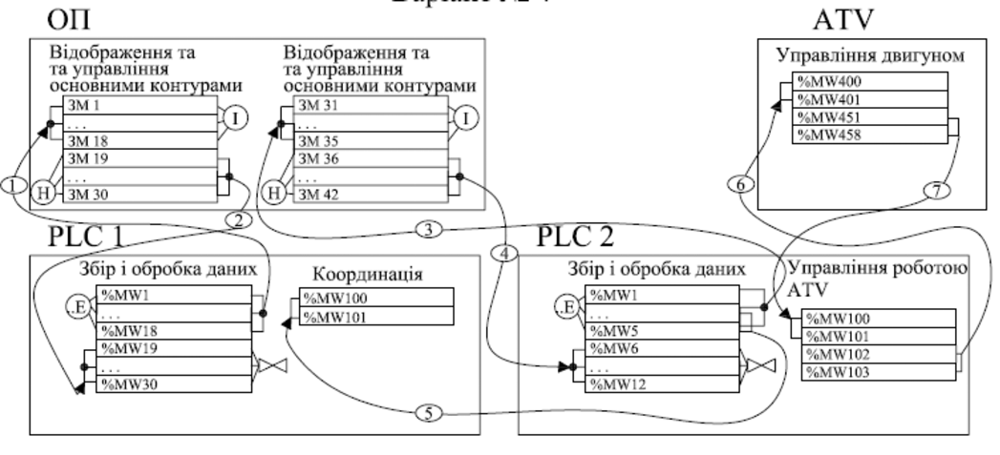

рис.2.4.

### Варіант №5

Таблиця.2.5(а)

| PC   | PLC3    | PLC1 | PLC2 |
| ---- | ------- | ---- | ---- |
| -    | S7-1200 | M221 | M221 |

Таблиця.2.5(б)

|      | PC   | PLC3 | PLC1 | PLC2 |
| ---- | ---- | ---- | ---- | ---- |
| PC   |      | 10   | 1    | 1    |
| PLC3 |      |      | 1    | 1    |
| PLC1 |      |      |      | 1    |
| PLC2 |      |      |      |      |

рис.2.5.

### Варіант №6

Таблиця.2.6(а)

| PLC1 | ATV  | PLC2 | PLC3    |
| ---- | ---- | ---- | ------- |
| M340 | -    | M221 | VIPA200 |

Таблиця.2.6(б)

|      | PLC1 | ATV  | PLC2 | PLC3 |
| ---- | ---- | ---- | ---- | ---- |
| PLC1 |      | 200  | 200  | 200  |
| ATV  |      |      | 200  | 200  |
| PLC2 |      |      |      | 200  |
| PLC3 |      |      |      |      |

рис.2.6.

### Варіант №7

Таблиця.2.7(а)

| PLC1 | PLC4    | PLC2    | PLC3    |
| ---- | ------- | ------- | ------- |
| M340 | S7-1200 | VIPA200 | VIPA200 |

Таблиця.2.7(б)

|      | PLC1 | PLC4 | PLC2 | PLC3 |
| ---- | ---- | ---- | ---- | ---- |
| PLC1 |      | 200  | 200  | 200  |
| PLC4 |      |      | 200  | 200  |
| PLC2 |      |      |      | 200  |
| PLC3 |      |      |      |      |

рис.2.7.

### Варіант №8

Таблиця.2.8(а)

| PLC1 | PLC4    | PLC2    | PLC3    |
| ---- | ------- | ------- | ------- |
| M340 | S7-1200 | VIPA200 | VIPA200 |

Таблиця.2.8(б)

|      | PLC1 | PLC4 | PLC2 | PLC3 |
| ---- | ---- | ---- | ---- | ---- |
| PLC1 |      | 200  | 200  | 200  |
| PLC4 |      |      | 200  | 200  |
| PLC2 |      |      |      | 200  |
| PLC3 |      |      |      |      |

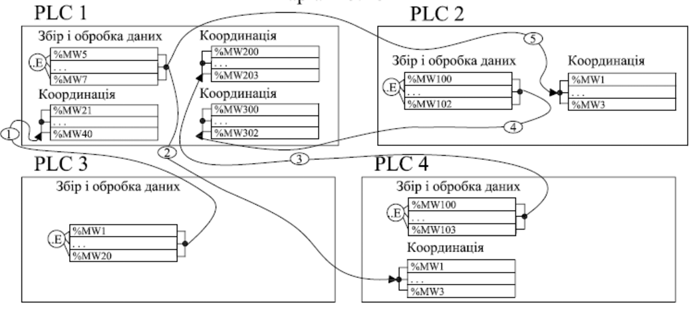

рис.2.8.

### Варіант №9

Таблиця.2.9(а)

| PLC1 | OP   | PLC2    | PLC3 |
| ---- | ---- | ------- | ---- |
| M340 | -    | VIPA200 | M221 |

Таблиця.2.9(б)

|      | PLC1 | OP   | PLC2 | PLC3 |
| ---- | ---- | ---- | ---- | ---- |
| PLC1 |      | 200  | 200  | 200  |
| OP   |      |      | 200  | 1    |
| PLC2 |      |      |      | 200  |
| PLC3 |      |      |      |      |

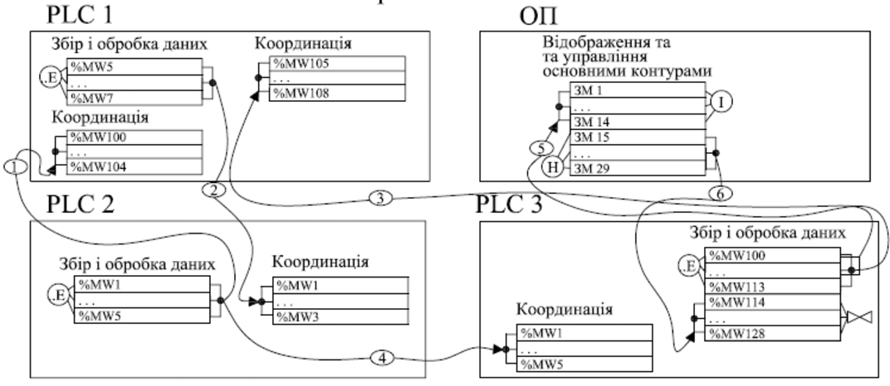

рис.2.9.

### Варіант №10

Таблиця.2.10(а)

| PLC1    | PLC4 | PLC2    | PLC3    |
| ------- | ---- | ------- | ------- |
| VIPA200 | M221 | VIPA200 | VIPA_s7 |

Таблиця.2.10(б)

|      | PLC1 | PLC4 | PLC2 | PLC3 |
| ---- | ---- | ---- | ---- | ---- |
| PLC1 |      | 200  | 200  | 200  |
| PLC4 |      |      | 200  | 200  |
| PLC2 |      |      |      | 200  |
| PLC3 |      |      |      |      |

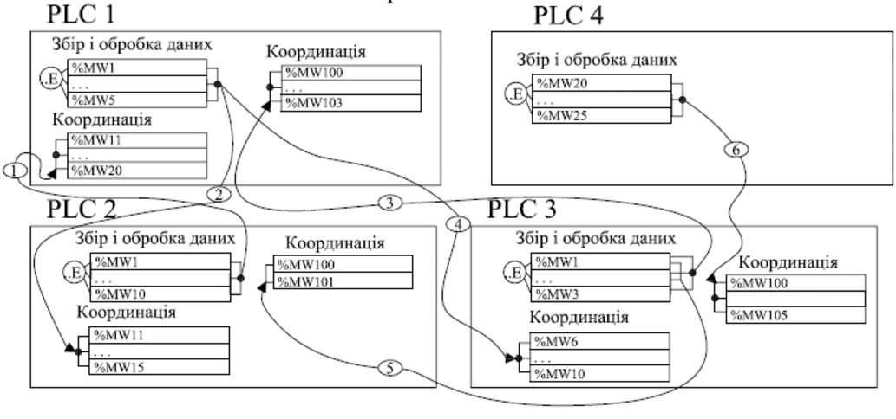

рис.2.10.

### Варіант №11

Таблиця.2.11(а)

| ATV  | OP   | PLC2 | PLC3    |
| ---- | ---- | ---- | ------- |
| -    | -    | M221 | VIPA200 |

Таблиця.2.11(б)

|      | ATV  | OP   | PLC2 | PLC3 |
| ---- | ---- | ---- | ---- | ---- |
| ATV  |      | 200  | 200  | 200  |
| OP   |      |      | 1    | 200  |
| PLC2 |      |      |      | 200  |
| PLC3 |      |      |      |      |

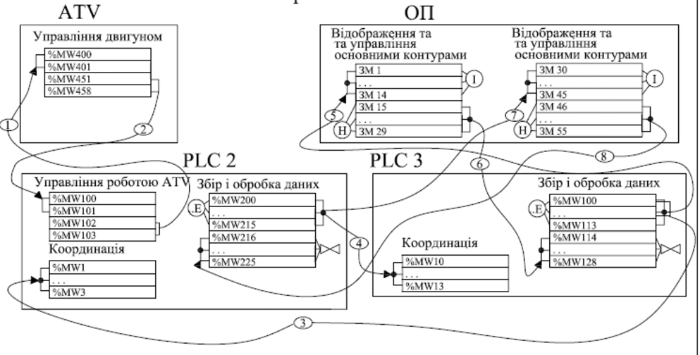

рис.2.11.

### Варіант №12

Таблиця.2.12(а)

| OP1  | OP2  | PLC1 | PLC2 |
| ---- | ---- | ---- | ---- |
| -    | -    | M221 | M221 |

Таблиця.2.12(б)

|      | OP1  | OP2  | PLC1 | PLC2 |
| ---- | ---- | ---- | ---- | ---- |
| OP1  |      | 200  | 1    | 200  |
| OP2  |      |      | 200  | 1    |
| PLC1 |      |      |      | 200  |
| PLC2 |      |      |      |      |

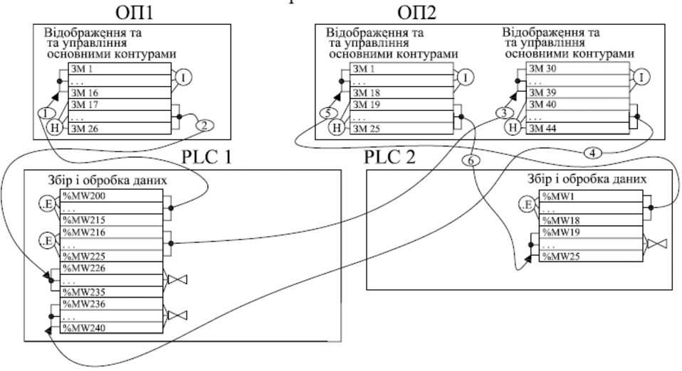

рис.2.12.

### Варіант №13

Таблиця.2.13(а)

| ATV1 | ATV2 | PLC1 | PLC2 |
| ---- | ---- | ---- | ---- |
| -    | -    | M340 | M221 |

Таблиця.2.13(б)

|      | ATV1 | ATV2 | PLC1 | PLC2 |
| ---- | ---- | ---- | ---- | ---- |
| ATV1 |      | 200  | 200  | 200  |
| ATV2 |      |      | 200  | 200  |
| PLC1 |      |      |      | 200  |
| PLC2 |      |      |      |      |

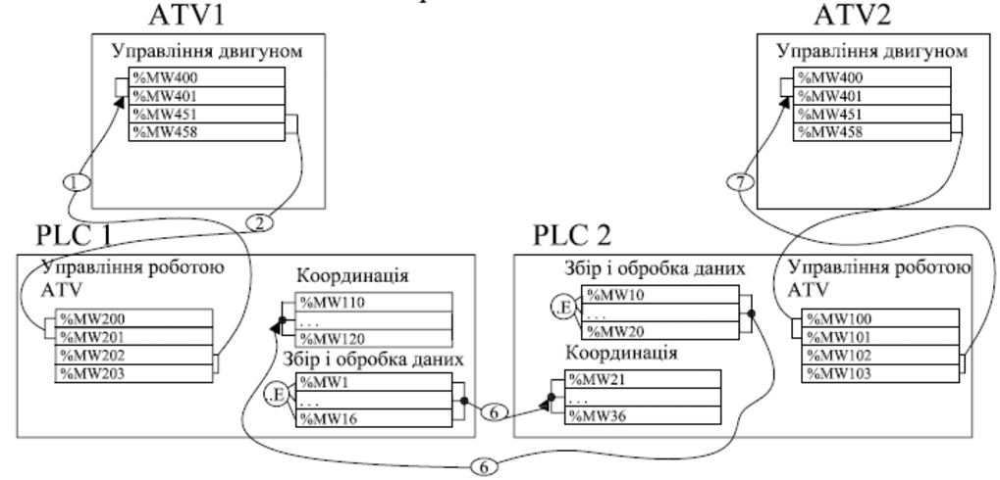

рис.2.13.

### Варіант №14

Таблиця.2.14(а)

| PLC1    | OP   | PLC2    | PLC3 |
| ------- | ---- | ------- | ---- |
| VIPA200 | -    | VIPA200 | M221 |

Таблиця.2.14(б)

|      | PLC1 | OP   | PLC2 | PLC3 |
| ---- | ---- | ---- | ---- | ---- |
| PLC1 |      | 200  | 200  | 200  |
| OP   |      |      | 200  | 1    |
| PLC2 |      |      |      | 200  |
| PLC3 |      |      |      |      |

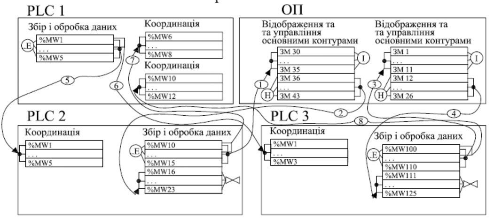

рис.2.14.

### Варіант №15

Таблиця.2.15(а)

| ATV  | PLC1    | PLC2 | PLC3 |
| ---- | ------- | ---- | ---- |
| -    | S7-1200 | M340 | M221 |

Таблиця.2.15(б)

|      | ATV  | PLC1 | PLC2 | PLC3 |
| ---- | ---- | ---- | ---- | ---- |
| ATV  |      | 200  | 200  | 200  |
| PLC1 |      |      | 200  | 200  |
| PLC2 |      |      |      | 200  |
| PLC3 |      |      |      |      |

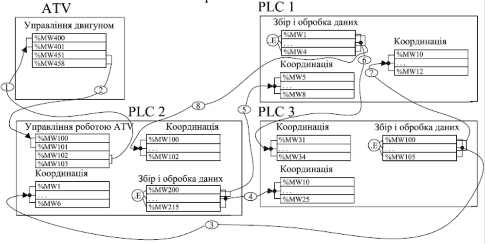

рис.2.15.

### Варіант №16

Таблиця.2.16(а)

| PC   | OP   | PLC1    | PLC2 |
| ---- | ---- | ------- | ---- |
| -    | -    | VIPA200 | M221 |

Таблиця.2.16(б)

|      | PC   | OP   | PLC1 | PLC2 |
| ---- | ---- | ---- | ---- | ---- |
| PC   |      | 200  | 10   | 200  |
| OP   |      |      | 200  | 1    |
| PLC1 |      |      |      | 200  |
| PLC2 |      |      |      |      |

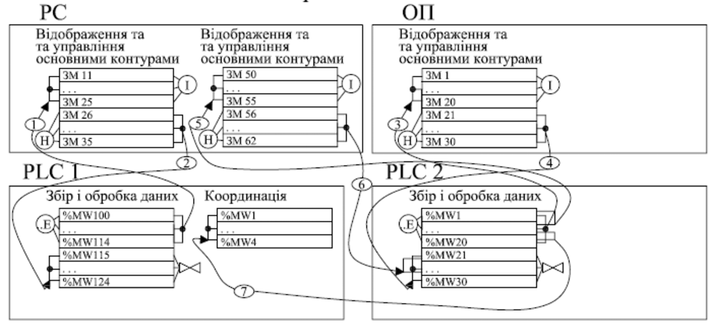

рис.2.16.

### Варіант №17

Таблиця.2.17(а)

| PC   | OP   | PLC1    | PLC2 |
| ---- | ---- | ------- | ---- |
| -    | -    | VIPA200 | M221 |

Таблиця.2.17(б)

|      | PC   | OP   | PLC1 | PLC2 |
| ---- | ---- | ---- | ---- | ---- |
| PC   |      | 200  | 200  | 200  |
| OP   |      |      | 200  | 1    |
| PLC1 |      |      |      | 200  |
| PLC2 |      |      |      |      |

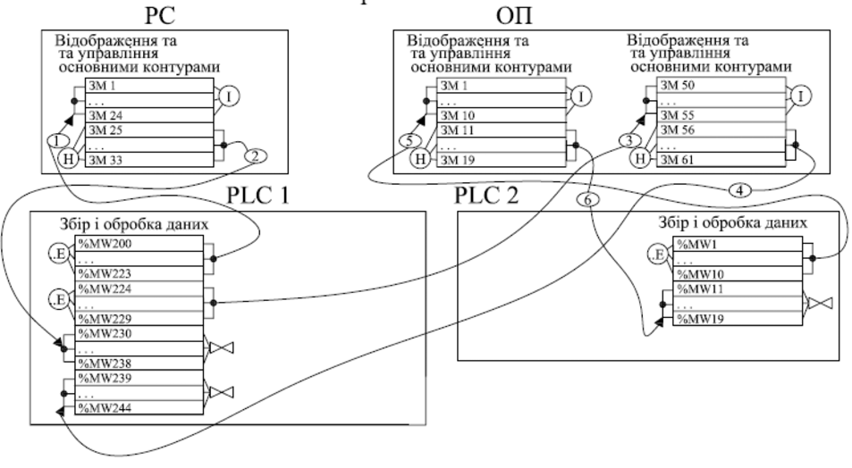

рис.2.17.

### Варіант №18

Таблиця.2.18(а)

| OP   | ATV  | PLC1 | PLC2    |
| ---- | ---- | ---- | ------- |
| -    | -    | M221 | VIPA200 |

Таблиця.2.18(б)

|      | OP   | ATV  | PLC1 | PLC2 |
| ---- | ---- | ---- | ---- | ---- |
| OP   |      | 200  | 1    | 200  |
| ATV  |      |      | 200  | 200  |
| PLC1 |      |      |      | 200  |
| PLC2 |      |      |      |      |

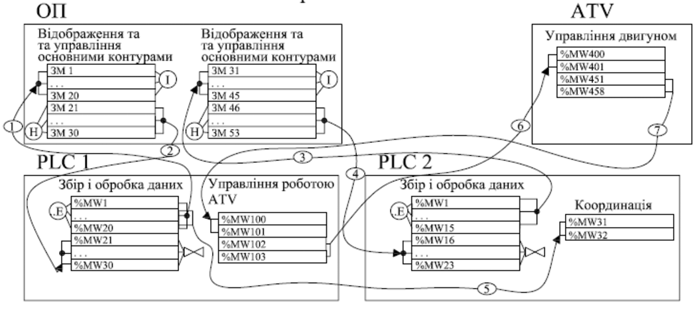

рис.2.18.

### Варіант №19

Таблиця.2.19(а)

| ATV  | PC   | PLC1    | PLC2 |
| ---- | ---- | ------- | ---- |
| -    | -    | VIPA200 | M221 |

Таблиця.2.19(б)

|      | ATV  | PC   | PLC1 | PLC2 |
| ---- | ---- | ---- | ---- | ---- |
| ATV  |      | 200  | 200  | 200  |
| PC   |      |      | 200  | 1    |
| PLC1 |      |      |      | 200  |
| PLC2 |      |      |      |      |

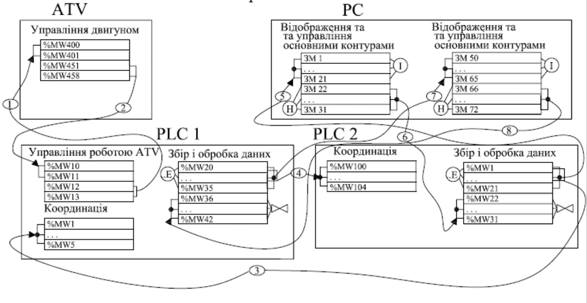

рис.2.19.

### Варіант №20

Таблиця.2.20(а)

| PLC1 | PLC2    | PLC3    | PLC4 |
| ---- | ------- | ------- | ---- |
| M221 | VIPA200 | S7-1200 | M340 |

Таблиця.2.20(б)

|      | PLC1 | PLC2 | PLC3 | PLC4 |
| ---- | ---- | ---- | ---- | ---- |
| PLC1 |      | 200  | 200  | 200  |
| PLC2 |      |      | 200  | 200  |
| PLC3 |      |      |      | 200  |
| PLC4 |      |      |      |      |

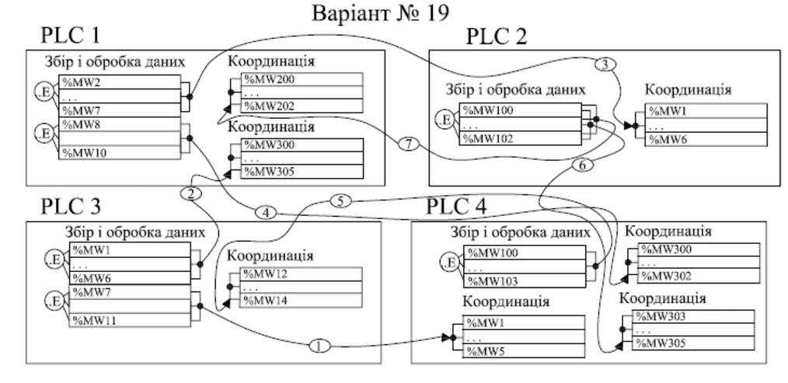

рис.2.20.

### Варіант №21

Таблиця.2.21(а)

| PC   | PLC1 | PLC2 | PLC3 |
| ---- | ---- | ---- | ---- |
| -    | M221 | M221 | M221 |

Таблиця.2.21(б)

|      | PC   | PLC1 | PLC2 | PLC3 |
| ---- | ---- | ---- | ---- | ---- |
| PC   |      | 200  | 1    | 200  |
| PLC1 |      |      | 200  | 200  |
| PLC2 |      |      |      | 200  |
| PLC3 |      |      |      |      |

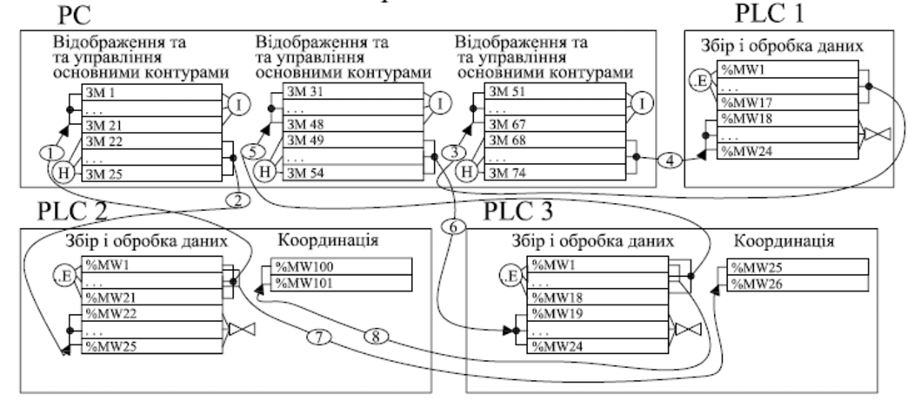

рис.2.21.

### Варіант №22

Таблиця.2.22(а)

| PC1  | PC2  | PLC1 | PLC2    |
| ---- | ---- | ---- | ------- |
| -    | -    | M221 | VIPA200 |

Таблиця.2.22(б)

|      | PC1  | PC2  | PLC1 | PLC2 |
| ---- | ---- | ---- | ---- | ---- |
| PC1  |      | 200м | 1м   | 200м |
| PC2  |      |      | 200м | 10м  |
| PLC1 |      |      |      | 200м |
| PLC2 |      |      |      |      |

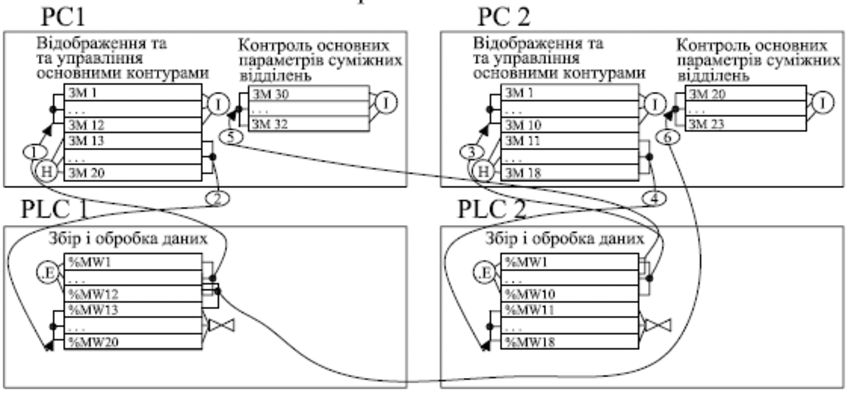

рис.2.22.

### Варіант №23

Таблиця.2.23(а)

| PC   | OP   | PLC1    | PLC2 |
| ---- | ---- | ------- | ---- |
| -    | -    | S7-1200 | M221 |

Таблиця.2.23(б)

|      | PC   | OP   | PLC1 | PLC2 |
| ---- | ---- | ---- | ---- | ---- |
| PC   |      | 200  | 10   | 10   |
| OP   |      |      | 10   | 1    |
| PLC1 |      |      |      | 10   |
| PLC2 |      |      |      |      |

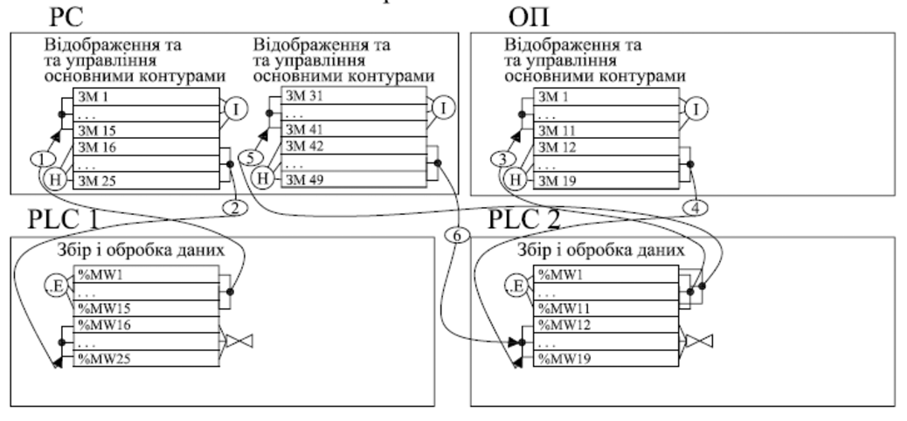

рис.2.23.

### Варіант №24

Таблиця.2.24(а)

| PC   | PLC1    | PLC2 | ATV  |
| ---- | ------- | ---- | ---- |
| -    | S7-1200 | M221 |      |

Таблиця.2.24(б)

|      | PC   | PLC1 | PLC2 | ATV  |
| ---- | ---- | ---- | ---- | ---- |
| PC   |      | 200  | 200  | 200  |
| PLC1 |      |      | 200  | 200  |
| PLC2 |      |      |      | 200  |
| ATV  |      |      |      |      |

рис.2.24.

### Варіант №25

Таблиця.2.25(а)

| OP   | ATV  | PLC1 | PLC2    |
| ---- | ---- | ---- | ------- |
| -    | -    | M221 | VIPA200 |

Таблиця.2.25(б)

|      | OP   | ATV  | PLC1 | PLC2 |
| ---- | ---- | ---- | ---- | ---- |
| OP   |      | 200  | 1    | 200  |
| ATV  |      |      | 200  | 200  |
| PLC1 |      |      |      | 200  |
| PLC2 |      |      |      |      |

рис.2.25.

### Варіант №26

Таблиця.2.26(а)

| PC   | PLC3    | PLC1    | PLC2    |
| ---- | ------- | ------- | ------- |
| -    | VIPA200 | VIPA200 | VIPA200 |

Таблиця.2.26(б)

|      | PC   | PLC3 | PLC1 | PLC2 |
| ---- | ---- | ---- | ---- | ---- |
| PC   |      | 200  | 200  | 200  |
| PLC3 |      |      | 200  | 200  |
| PLC1 |      |      |      | 200  |
| PLC2 |      |      |      |      |

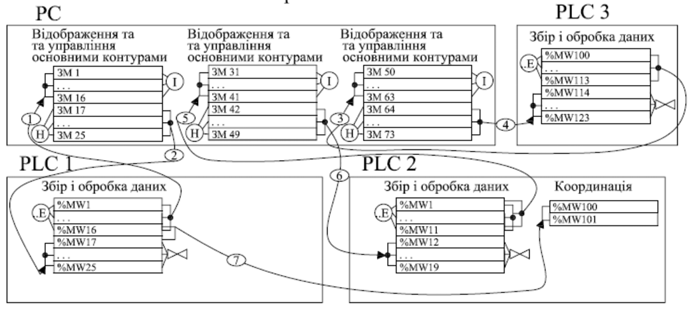

рис.2.26.

### Варіант №27

Таблиця.2.27(а)

| PLC1    | ATV  | PLC2    | PLC3 |
| ------- | ---- | ------- | ---- |
| S7-1200 | -    | VIPA200 | M221 |

Таблиця.2.27(б)

|      | PLC1 | ATV  | PLC2 | PLC3 |
| ---- | ---- | ---- | ---- | ---- |
| PLC1 |      | 200  | 200  | 200  |
| ATV  |      |      | 200  | 200  |
| PLC2 |      |      |      | 200  |
| PLC3 |      |      |      |      |

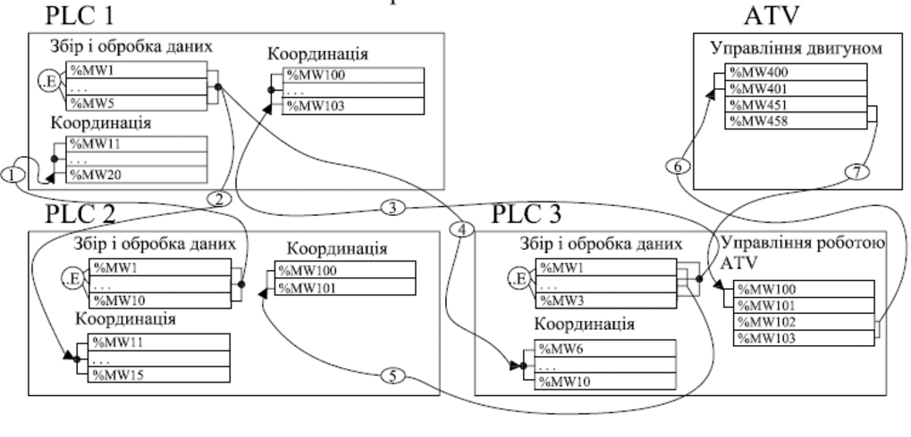

рис.2.27.

## Питання для самоконтролю знань

1. Яка модель доступу до шини використовується в Modbus RTU?
2. Які обмеження на кількість ведучих пристроїв у мережі Modbus RTU?
3. У якому діапазоні мають бути адреси пристроїв?
4. Чим відрізняються формати RTU і ASCII?
5. Які типи пристроїв можуть виступати як Client?
6. Чому HMI зазвичай виступає в ролі Client?
7. Як впливає на мережу запит до пристрою, що відсутній?
8. Скільки пристроїв можна під’єднати до однієї шини RS-485 без повторювачів?
9. Чим зумовлене обмеження на одночасні з’єднання в Modbus RTU?
10. Які вимоги до узгодження фізичних інтерфейсів у мережі?
11. Для чого використовуються адаптери RS232–RS485?
12. Як враховувати довжину лінії при проєктуванні?
13. Коли і навіщо використовуються термінатори в RS-485?
14. Як обрахувати орієнтовний час одного циклу опитування?
15. Які причини можуть призводити до CRC-помилок?
16. Що таке тайм-аут у контексті Modbus RTU?
17. Як здійснюється запис даних з HMI?
18. Що таке широкомовна адреса в Modbus і чи використовується вона в RTU?
19. Чому кількість клієнтів не може бути більше одного у класичній Modbus RTU мережі?
20. Що робити, якщо потрібно підключити кілька Client-пристроїв?
21. Як впливають функції архівації та тривог в SCADA на періодичність запитів?
22. Чому важливо знати набір підтримуваних функцій кожного Slave?
23. Яка структура логіки обміну при Client–Server моделі?
