# Практичне заняття 3. Правила побудови мереж на базі Ethernet та TCP/IP

## Основні теоретичні відомості

У даному практичному занятті розглядаються принципи проектування мережних архітектур промислового Ethernet та TCP/IP з використанням рішень на базі ePAC M580 від Schneider Electric. 

### Кільцева топологія на витій парі

Кільцева топологія (ring topology) в контексті промислового Ethernet — це спосіб організації мережі, в якому кожен вузол підключається до двох сусідніх, утворюючи замкнене коло. Такий підхід забезпечує високий рівень надійності за рахунок можливості автоматичного резервування шляху у разі розриву лінії або відмови одного з вузлів.

На відміну від офісних або загальнопромислових мереж, у промисловому середовищі до кільцевих топологій висуваються суворі вимоги щодо детермінізму, часу відновлення з’єднання, електромагнітної стійкості та керування трафіком. Тому для реалізації кільця в промисловому Ethernet застосовуються спеціалізовані механізми резервування та топологічного керування.

Найбільш поширені протоколи, що підтримують кільцеву структуру в реальному часі:

- **RSTP (Rapid Spanning Tree Protocol)** — стандарт IEEE 802.1w. Використовується як базовий механізм запобігання мережевим петлям і резервування шляху. Підтримується більшістю промислових керованих комутаторів, а також інтегрується в деякі ПЛК та адаптери вводу/виводу. Час відновлення типово становить 50–500 мс, залежно від конфігурації.

  **MRP (Media Redundancy Protocol)** — стандарт IEC 62439-2. Оптимізований для промислових систем з кільцем, що містить до 50 пристроїв. Підтримується переважно у Profinet-пристроях. Забезпечує час відновлення до 200 мс при одному розриві.

  **DLR (Device Level Ring)** — специфікація ODVA для EtherNet/IP. Застосовується в невеликих кільцях (до 10–15 вузлів), де один пристрій виконує роль Ring Supervisor. Дає змогу відновити зв’язок за <3 мс. Поширений у пристроях Rockwell Automation, Turck, HMS.

  **PRP (Parallel Redundancy Protocol)** та **HSR (High-availability Seamless Redundancy)** — стандарти IEC 62439-3. Застосовуються в критично важливих мережах, де потрібно мати повну безперервність передачі без втрати кадрів (наприклад, у енергетиці та транспорті). Не формують кільце як таке, але реалізують надлишковість на фізичному рівні.

  **Пропрієтарні протоколи** — такі як Turbo Ring (Moxa), HiRing (Hirschmann), Fast Ring (Weidmüller) або Redundant Ring від Schneider Electric. Зазвичай орієнтовані на зменшення часу перемикання і оптимізацію для обладнання конкретного виробника.

Принцип дії зазвичай передбачає наявність одного або кількох пристроїв, які виконують функцію керування кільцем (Ring Manager або Supervisor). Вони постійно перевіряють цілісність шляху. Якщо виявляється розрив, трафік перенаправляється альтернативним маршрутом, зазвичай у зворотному напрямку.

Ключовими перевагами кільцевих топологій у промисловому Ethernet є:

- короткий час відновлення зв’язку (в межах кількох мс),
- відсутність необхідності в центральному комутаторі,
- гнучкість масштабування (можна додавати вузли без порушення роботи системи),
- підвищена стійкість до одиничних відмов.

Однак кільцеві мережі мають і обмеження: максимальна кількість вузлів зазвичай обмежена (наприклад, 50 для MRP, 10–20 для DLR), зростає затримка, ускладнюється діагностика. Також критично дотримуватись вимог до якості кабелів, екранування, заземлення, а також правильного налаштування пріоритетів трафіку (QoS, VLAN, DSCP) для запобігання колізіям та втратам.

У більш складних системах кільцева топологія може поєднуватись з іншими (наприклад, кільце-зірка, подвійне кільце), що дозволяє забезпечити географічну гнучкість і функціональну сегментацію мережі.

У контексті побудови кільцевих топологій у промисловому Ethernet слід особливо наголосити: звичайні (некеровані) комутатори категорично не можна з'єднувати в кільце. Це створює мережеву петлю, яка призводить до неконтрольованого розмноження широкомовних пакетів (broadcast storm).

Оскільки некеровані комутатори не мають механізмів виявлення та усунення петель, як-от STP (Spanning Tree Protocol), мережеві кадри можуть нескінченно циркулювати між портами. У результаті це призводить до:

- паралічу всієї мережі — усі пристрої втрачають доступ одне до одного;

- перевантаження портів і буферів комутаторів;

- повного зникнення зв'язку навіть на фізично справних сегментах;

- втрати даних або збою систем керування, якщо мережа використовується для передачі керуючих команд або сигналів.

Це особливо критично в системах автоматизації, де мережа є основним каналом обміну між контролерами, пристроями вводу/виводу, HMI та SCADA. Тому побудова кільця має виконуватись лише з використанням керованих комутаторів, що підтримують відповідні протоколи резервування (RSTP, MRP, DLR тощо) або спеціалізованих пристроїв з попередньо налаштованою поведінкою в кільці.

### Використання оптоволокна

Використання оптоволоконних каналів у промислових Ethernet-мережах є стандартною практикою у випадках, коли необхідно забезпечити високу надійність, швидкість та захист від електромагнітних завад. На відміну від мідних з’єднань, оптоволокно забезпечує повну гальванічну розв’язку між вузлами, що критично важливо у великомасштабних інсталяціях з різним потенціалом заземлення.

Оптоволоконні з'єднання дозволяють подолати обмеження за відстанню: якщо стандартна витa пара обмежена 100 метрами, то одномодові волоконно-оптичні лінії можуть досягати десятків кілометрів, а багатомодові — до кількох кілометрів. Це робить оптоволокно ідеальним вибором для міжцехових або міжбудинкових з’єднань, особливо у розподілених виробничих системах.

Ще однією перевагою є стійкість до електромагнітних завад (EMI). У середовищах із високими струмами, індукційними навантаженнями або частими імпульсними переходами мідні з’єднання можуть бути вразливими до перешкод. Оптоволокно повністю інертне до EMI, що забезпечує стабільну комунікацію навіть у найагресивніших умовах.

У промислових Ethernet-мережах оптоволоконні інтерфейси реалізуються через SFP-модулі, медіаконвертери або вбудовані порти комутаторів. Вони можуть бути налаштовані для роботи на різних швидкостях (100 Мбіт/с, 1 Гбіт/с і вище) та використовувати різні стандарти — наприклад, 100Base-FX або 1000Base-LX. У топологічному плані оптоволокно використовується для створення магістральних з’єднань (uplink), резервованих кілець або зіркоподібної інфраструктури.

З технічного боку важливо враховувати тип волокна (одномодове або багатомодове), тип роз’ємів (SC, LC, ST), а також правильний підбір SFP-модуля до довжини лінії. Також слід дотримуватись стандартів індустріального монтажу — механічного захисту, герметизації, контролю радіусу вигину тощо.

### Комутатори та маршрутизатори

У промисловому Ethernet комутатори й маршрутизатори відіграють ключову роль у побудові надійної, масштабованої та безпечної мережевої інфраструктури. Підхід до їх використання відрізняється від офісних або ІТ-середовищ через підвищені вимоги до детермінізму, резервування та стійкості до завад.

Комутатори в промислових мережах зазвичай мають розширений функціонал порівняно зі звичайними керованими моделями. Вони підтримують пріоритезацію трафіку (QoS), VLAN, механізми резервування (RSTP, MRP, DLR), моніторинг стану лінків і журналювання подій. У критичних ділянках часто використовуються спеціалізовані промислові комутатори з попередньо налаштованими шаблонами, які забезпечують гарантовану швидкість перемикання та мінімальний час відновлення зв'язку. Це дозволяє уникнути помилок і пришвидшити введення системи в експлуатацію.

У промисловому Ethernet досі зберігається актуальність використання некерованих комутаторів, особливо в простих або локалізованих ділянках мережі. Вони забезпечують базову функцію — фізичне з'єднання кількох пристроїв на рівні канального рівня (L2) без жодної логіки маршрутизації, сегментації або контролю доступу. Основною перевагою таких комутаторів є низька вартість, простота впровадження та мінімальні вимоги до налаштування — фактично вони працюють за принципом «plug and play».

Некеровані комутатори доречно використовувати в ізольованих сегментах, де немає потреби в резервуванні, пріоритезації трафіку чи логічному розділенні (VLAN). Це можуть бути, наприклад, невеликі машинні зони, окремі шафи керування або підключення окремих периферійних пристроїв без критичних вимог до часу відгуку. Водночас, навіть у таких умовах варто бути обережним: якщо виникає необхідність об'єднати два або більше некерованих комутатори в кільце або допустити надлишкове широкомовлення, це може спричинити збої у всій мережі.

Коли мережа розширюється, з’являються вимоги до контролю трафіку, ізоляції зон, пріоритету сигналів чи захисту від петель — на цьому етапі некеровані комутатори вже не здатні забезпечити необхідний рівень надійності. У таких випадках доцільно використовувати керовані моделі, які підтримують діагностику, конфігурацію через веб-інтерфейс або SNMP, налаштування QoS, VLAN, а також протоколи резервування. Особливо це актуально для магістральних сегментів, кілець, з'єднань між підсистемами або при наявності змішаного трафіку різного пріоритету.

Таким чином, вибір між некерованими та керованими комутаторами залежить не лише від складності мережі, а й від вимог до її масштабованості, безпеки, надійності та швидкодії. Некеровані пристрої можуть бути корисними, але їх варто розглядати як виняток, а не основу сучасної промислової мережі.

Маршрутизатори застосовуються для розмежування логічних або фізичних сегментів мережі, забезпечення безпеки (через ACL, NAT, брандмауер) та керування маршрутизацією між підсистемами або рівнями автоматизації. У сучасних архітектурах вони також часто поєднують функції шлюзу протоколів (наприклад, між Modbus TCP і OPC UA) та VPN-доступу для віддаленого обслуговування.

У проєктуванні промислових мереж важливо визначити функціональну роль кожного пристрою: де потрібне комутаційне середовище з мінімальними затримками, а де — маршрутизація, захист або доступ до зовнішніх мереж. У складних системах дедалі частіше застосовуються багаторівневі структури з чітким розподілом між рівнями польового збирання даних, керування та підприємства, де комутатори й маршрутизатори використовуються відповідно до своїх задач.

### Прокладання кабелів та заземлення екранів 

У промислових Ethernet-мережах правильне прокладання кабелів та заземлення екранів має критичне значення для забезпечення стабільної роботи системи, захисту від електромагнітних завад і уникнення паразитних струмів. Особливо це стосується екранованих кабелів, які часто використовуються для з’єднань між контролерами, адаптерами вводу/виводу, комутаторами та іншими пристроями.

Згідно з рекомендаціями Schneider Electric, екран Ethernet-кабелю повинен бути заземлений **на обох кінцях**. Це пояснюється тим, що всі Ethernet-порти пристроїв M580 (CPU, CRA тощо) мають конструктивне з’єднання з корпусом, а отже — з системою заземлення. За умови правильно реалізованої еквіпотенційної системи заземлення така схема є безпечною і забезпечує ефективне екранування по всій довжині лінії. Якщо ж екран заземлений лише з одного боку, або якщо в системі існують різні потенціали, екран може не виконувати свою функцію або навіть створювати зворотний ефект — стати джерелом наводок.

Усі корпуси обладнання, до якого підключено кабелі, повинні бути надійно підключені до єдиного заземлювального контуру. Відхилення в потенціалі між точками підключення можуть призвести до протікання небезпечних струмів по екрану. У документації також зазначається, що при підозрі на порушення еквіпотенційності екранований кабель слід вважати потенційно небезпечним, і працювати з ним лише з дотриманням засобів індивідуального захисту.

Під час прокладання кабелів слід уникати спільного монтажу сигнальних і силових ліній в одному лотку, витримувати допустимі радіуси вигину та забезпечити фіксацію кабелю без натягу. У з’єднаннях слід використовувати промислові конектори із забезпеченням суцільного електричного контакту між екраном і корпусом пристрою, а також уникати підключення кабелів до обладнання з ізольованими портами без заземлення.

У випадках, коли забезпечити якісне екранування і заземлення неможливо (наприклад, при великій відстані між вузлами або відсутності єдиного контуру заземлення), доцільно розглянути використання оптоволоконних з’єднань як альтернативу.

Якщо уникнути перетину силових кабелів та ліній витої пари неможливо, слід дотримуватись кількох важливих правил для мінімізації електромагнітного впливу на сигнальну лінію.

По-перше, перетин має відбуватись під прямим кутом (близько 90°). Це дозволяє зменшити тривалість дії індукованого поля та мінімізує взаємні наведення. Якщо перетин виконано під кутом, близьким до 0° або 180°, довжина спільного шляху зростає, і відповідно зростає ймовірність перешкод.

По-друге, рекомендується використовувати екрановані Ethernet-кабелі (STP/FTP), а також кабелі з щільно скрученими парами, що краще протистоять зовнішнім електромагнітним полям. При цьому екран має бути заземлений на обох кінцях, як описано раніше.

По-третє, при проектуванні лотків і кабельних каналів бажано забезпечити максимально можливу відстань між паралельно прокладеними ділянками, навіть якщо вони розміщені в окремих відсіках. Мінімальна рекомендована відстань між паралельними силовими й сигнальними лініями — від 10 до 20 см, залежно від рівня струмів і напруги.

Якщо ж силові кабелі належать до змінного струму, або до частотно-регульованих приводів, і створюють сильні перешкоди, слід розглянути застосування екранованих лотків, металевих перегородок, або навіть оптоволоконних сегментів у найбільш критичних ділянках. У промисловій практиці також іноді використовують перетин у різних висотних площинах — наприклад, сигнальні кабелі розміщуються вгорі, а силові — внизу, з додатковим заземленим екраном між ними.

### Службові протоколи в промисловому Ethernet

У промисловому Ethernet, окрім протоколів, які безпосередньо забезпечують передачу прикладних даних (наприклад, Modbus TCP, EtherNet/IP, OPC UA), широко використовуються службові протоколи, що не беруть участі у власне процесному обміні, але відіграють ключову роль у підтриманні стабільності, керованості й передбачуваності мережі.

Одним із базових механізмів є **QoS (Quality of Service)** — це сукупність технологій, які дозволяють розподіляти пропускну здатність мережі між різними типами трафіку за пріоритетністю. Завдяки QoS пакети з критичним значенням для керування можуть отримувати вищий пріоритет при обробці в комутаторах. У промислових умовах це дозволяє уникнути затримок у передачі сигналів керування навіть при великому загальному трафіку в мережі.

Іншим важливим інструментом є **SNMP (Simple Network Management Protocol)**. Його використовують для моніторингу, діагностики та керування мережевим обладнанням — комутаторами, маршрутизаторами, точками доступу. Через SNMP системи верхнього рівня можуть отримувати інформацію про стан портів, помилки, статистику трафіку, а також надсилати команди для зміни конфігурації або перезапуску пристроїв. Це особливо корисно при дистанційному обслуговуванні або в великих розподілених мережах.

До службових також належать протоколи типу **LLDP (Link Layer Discovery Protocol)**, що дозволяють вузлам обмінюватись інформацією про свою конфігурацію та сусідів. Це спрощує автоматизовану побудову топології мережі, особливо в середовищах з частими змінами. **PTP (Precision Time Protocol)** — ще один службовий протокол, що забезпечує синхронізацію годинника між вузлами з точністю до мікросекунд, що важливо для часової координації процесів.

Нарешті, варто згадати **DHCP (Dynamic Host Configuration Protocol)**, який несе відповідальність за автоматичну видачу IP-адрес і параметрів мережі, та **DNS**, який забезпечує розпізнавання імен хостів. У багатьох випадках такі служби працюють у фоновому режимі, але є критично важливими для функціонування мережі загалом, особливо якщо в системі є пристрої, що взаємодіють за іменами або підтримують динамічну конфігурацію.

### Архітектура контролера M580

M580 — це Ethernet-програмований контролер (ePAC), що підтримує розподілену обробку та інтеграцію в системи IIoT. Основні компоненти: CPU (з портами Ethernet), модулі DIO, адаптери RIO (CRA), комунікаційні модулі NOC, SCADA/HMI. На рис.3.1 показаний зовнішній вигляд CPU.

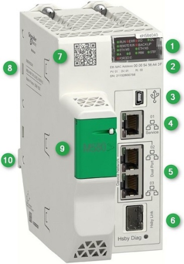

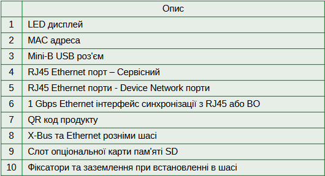

рис.3.1. Зовнішній вигляд CPU M580 з резервуванням.

Архітектура M580 підтримує два типи внутрішніх шин для обміну між CPU та модулями вводу/виводу на тому ж шассі (рис.3.2):

- X-Bus, використовується для класичних модулів вводу/виводу (X80) та забезпечує базову функціональність без підтримки Ethernet-засобів.
- Ethernet backplane (E-Bus) Внутрішній Ethernet-комутатор на базовій платі шассі (rack), який з'єднує CPU з іншими модулями (наприклад, NOC, CRA). Дає змогу реалізувати розподілену архітектуру всередині шассі, використовуючи стандартні Ethernet-протоколи.

Через Ethernet backplane bus  (не плутати з зовнішнім Ethernet)  CPU спілкується з NOC, CRA, RIO scanner, DIO scanner — і це критично при оцінці пропускної здатності та детермінізму.

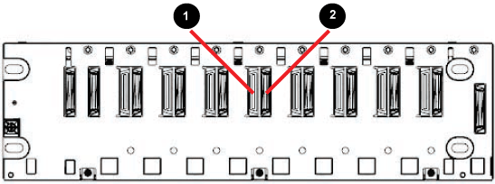

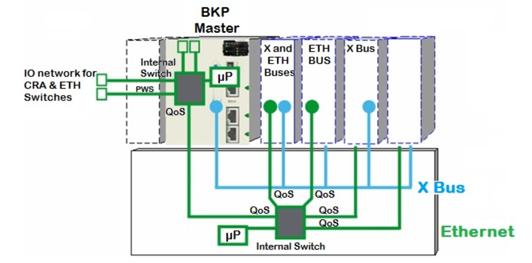

рис.3.2. Архітектура внутрішнього обміну по шассі: 1) роз'єм для підключення модулів через Ethernet; 2) роз'єм для підключення модулів через X-Bus  

У системі керування на базі M580 відрізняють два основних типи комунікацій по Ethernet:

- RIO-комунікації (Remote I/O) — це детермінований циклічний обмін між CPU та адаптерами вводу/виводу (CRA) по спеціальному RIO-кільцю. Він синхронізований з основним циклом задач (MAST) та має високий пріоритет. Цей обмін управляється службою **RIO Scanner Service** і використовується для забезпечення точного й гарантованого часу реакції системи.
- DIO-комунікації (Distributed I/O) — це циклічний або ациклічний обмін, але з нижчим пріоритетом і менш суворими вимогами до часу. Він керується DIO Scanner Service, період опитування задається конфігураційно, але не синхронізується з MAST. До DIO також належать усі інші Ethernet-обміни — через комунікаційні функції (наприклад, READ_VAR), HMI, SCADA, OPC та інші протоколи. Такі комунікації можуть бути подані у вигляді окремих сервісів в архітектурі системи.

### RIO

Архітектура RIO передбачає наявність таких компонентів в мережі (рис.3.3):

1. Процесор контролера M580 з активованою службою RIO Scanner. Тільки ті моделі CPU, назва яких закінчується на *40 (наприклад, BMEP584040, BMEP582040), мають вбудований RIO Scanner Service та можуть виступати як ініціатор RIO-обміну. Порти Ethernet таких CPU безпосередньо беруть участь у побудові RIO-мережі.
2. Адаптери віддалених стійок вводу/виводу (CRA), які забезпечують зв’язок між RIO-мережею Ethernet та модулями I/O. Вони встановлюються у шасі, до яких підключаються модулі вводу/виводу. CRA має два Ethernet-порти для організації кільцевої або зіркової топології.
   - BMXCRA31200
   - BMXCRA31210
   - BMECRA31210, BMECRA31220, BMECRA31230 (підтримує Ethernet backplane)
3. Шасі з модулями вводу/виводу. Усі модулі вводу/виводу (аналогові, дискретні тощо) встановлюються безпосередньо в ті шасі, де розміщено адаптер CRA. Передача даних між CRA та модулями здійснюється через X-Bus — шину,.
4. Керовані комутатори для RIO. У кільцевій або зірковій мережі RIO дозволяється використовувати лише адаптери CRA або керовані комутатори, які спеціально сконфігуровані згідно з вимогами Schneider Electric. Вони повинні підтримувати пріоритети трафіку, фільтрацію широкомовних кадрів, ізоляцію VLAN, а в разі кільця — протоколи резервування (RSTP або DLR у виняткових конфігураціях).
5. Мережева топологія. Найбільш типова конфігурація — кільце (main ring), до якого можуть під’єднуватися підкільця (sub-rings). Усі сегменти повинні підтримувати вимоги щодо затримки, втрати кадрів та ART, описані в планувальній документації.

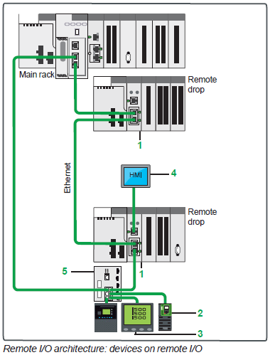

рис.3.3. Приклад RIO архітектури. BME CRA31210 drop adapter (1), Altivar Process variable speed drive (2), Energy supervision (3) and HMI (4),  ConneXium DRS (5).

У кільцевій топології на базі витої пари (Ethernet) для RIO-архітектури контролера M580 передача даних між CPU та віддаленими стійками (RIO drops) здійснюється по замкнутому шляху, де кожен вузол підключений до двох сусідніх — «вхід» та «вихід». Комунікація відбувається через порти Ethernet на адаптерах CRA, які мають по два гігабітних роз'єми RJ45. Саме ця конфігурація дозволяє побудувати кільце без використання додаткових комутаторів у кожному сегменті.

Комунікація в кільці реалізована із застосуванням протоколу RSTP (Rapid Spanning Tree Protocol), який інтегрований у CPU M580 (референси *40) та в порти адаптерів CRA. RSTP постійно відстежує топологію та автоматично переналаштовує маршрутизацію трафіку у разі обриву з’єднання або втрати вузла. У разі порушення кільця механізм RSTP активує резервну гілку, забезпечуючи безперервний обмін даними без необхідності ручного втручання. Для коректної роботи кільця всі пристрої в сегменті RIO мають підтримувати RSTP та бути налаштованими з правильним пріоритетом bridge-role (root, backup root, participant). Конфігурація виконується у Control Expert або через веб-інтерфейс керованого комутатора, якщо він використовується.

Фізичне з'єднання реалізується на основі витої пари категорії Cat 5e або вище, з типовим обмеженням 100 м між вузлами. До RIO-кільця дозволяється підключати тільки адаптери CRA та спеціально сконфігуровані керовані комутатори, які підтримують VLAN, пріоритезацію трафіку (QoS) та RSTP. Порти типу Service Port для побудови RIO-кільця не використовуються, оскільки не підтримують RSTP.

Побудова кільця на витій парі особливо доцільна на невеликих або середніх об'єктах, де використання оптоволокна недоцільне за витратами. При цьому варто враховувати обмеження CPU за кількістю RIO drops у кільці (наприклад, не більше 8), а також обов’язкову вимогу — використовувати лише адаптери CRA або дозволені керовані комутатори, конфігуровані відповідно до специфікацій Schneider Electric.

Комутатори від Schneider Electric, які підтримують архітектуру RIO (наприклад, Switch EEE, ConneXium серії), мають бути спеціально налаштовані згідно з вимогами RIO Scanner Service у контролерах M580. Вони використовуються лише в тих випадках, коли безпосереднє з’єднання між CPU та адаптерами CRA неможливе або коли кільце потребує розгалуження. Деякі з наперед заданих конфігурацій також передбачають можливість підключення пристроїв DIO. Це реалізовано через спеціально визначені порти, які виділені для менш критичного трафіку. Наприклад, у комутаторах DRS типу TCSESM або MCSESM деякі конфігурації (наприклад, C3, C5) дозволяють одночасно працювати як у RIO-кільці, так і як точка підключення до DIO пристроїв — з урахуванням пріоритезації та ізоляції трафіку. Порти, не задіяні у структурі кільця (зазвичай 3, 4 або 7), можуть використовуватись для підключення HMI, SCADA або DIO-пристроїв без порушення роботи RIO. Таким чином, у типовій конфігурації RIO-кільця на основі DRS-комутаторів можлива інтеграція DIO без додаткового ручного налаштування — за умови правильного вибору заводського профілю та підключення до відповідних портів. Це значно спрощує побудову мережі при збереженні її детермінованості та надійності.

### DIO

У системах на базі Modicon M580 під DIO зазвичай розуміється будь-який Ethernet-зв'язок із периферією, що **не використовує службу RIO Scanner**, тобто не є частиною жорстко синхронізованої RIO-мережі. DIO може охоплювати обмін із модулями вводу/виводу по Modbus TCP, EtherNet/IP, або реалізовуватись через функціональні виклики типу READ_VAR / WRITE_VAR. Крім класичних I/O, до DIO також зараховують обмін з HMI, серверами реєстрації даних або SCADA, якщо він не є частиною окремого логічного каналу.

Типова особливість DIO — гнучкість і масштабованість. Пристрої можна додавати без зміни конфігурації апаратного шасі контролера. Підключення реалізується через стандартні мережеві інтерфейси, а для обміну достатньо правильної адресації та підтримки обраного протоколу.

Водночас DIO має нижчий пріоритет порівняно з RIO. У системі M580 трафік DIO передається після обробки критичних даних RIO, у межах залишкової пропускної здатності мережі. Це означає, що DIO не слід застосовувати для задач, чутливих до часу, або там, де потрібна гарантована циклічність.

Ще однією особливістю DIO є відсутність централізованої служби керування, подібної до RIO Scanner. Відповідальність за моніторинг стану DIO-пристроїв, їх доступність та реакцію на помилки зазвичай лягає на саму програму контролера або верхній рівень системи. У цьому полягає і гнучкість, і додаткова складність реалізації.

У системах на базі Modicon M580 служби DIO можуть використовувати кілька типів Ethernet-інтерфейсів. Один із ключових — це вбудовані порти Ethernet на процесорному модулі (CPU). Ці порти позначаються як Device Network і мають різну поведінку залежно від моделі CPU. У CPU, що підтримують RIO (референси закінчуються на *40), порти Device Network використовуються передусім для побудови RIO-мережі, але на тих самих портах також доступні служби DIO — за умови правильного планування топології, налаштування VLAN і пріоритетів трафіку. Тобто RIO і DIO можуть фізично співіснувати на одному кабелі, якщо це дозволено обраною конфігурацією. У CPU, що не підтримують RIO (референси на *20), порти Device Network використовуються виключно для DIO, з повною підтримкою зіркової, ланцюгової та кільцевої топологій для розподіленого Ethernet-зв’язку.

Окрім вбудованих портів, для DIO-сервісів можуть використовуватись модулі комунікації типу NOC (BMENOC0301, BMENOC0311) — вони призначені для класичних Ethernet-з'єднань з іншими пристроями, з підтримкою Modbus TCP, EtherNet/IP, OPC тощо. BMENOC — це комунікаційні модулі для контролерів Modicon M580, які мають власний комунікаційний процесор, незалежний від основного CPU контролера. Завдяки цьому вони здатні обробляти мережевий трафік, виконувати обмін за кількома протоколами (наприклад, Modbus TCP, EtherNet/IP, OPC UA) та підтримувати функції сервера й клієнта без навантаження на основний процесор ПЛК. Таке розділення дозволяє досягти високої продуктивності та масштабованості — один BMENOC може обслуговувати десятки підключень одночасно, реалізовувати багатоканальний обмін із зовнішніми системами, вести діагностику, журналювання, або слугувати шлюзом між різними логічними сегментами мережі.

Оскільки BMENOC працює автономно, він має власні мережеві налаштування, IP-адресу, служби й механізми безпеки, конфігурується окремо в середовищі Control Expert. Це дозволяє відокремити канали обміну за функціональним призначенням (наприклад, виробничі дані, доступ до MES, резервне копіювання, віддалене обслуговування), забезпечуючи ізоляцію та надійність.

У проектах із високими вимогами до продуктивності, безпеки або логічної сегментації застосування BMENOC є найкращим варіантом, порівняно з використанням вбудованих портів CPU.

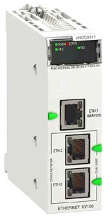 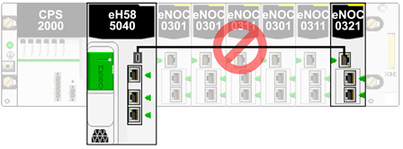

рис.3.4. Зовнішній вигляд модуля NOC 

Модулі серій BMENOC0301, BMENOC0311, BMENOC0321 підтримують такі сервіси:

- Modbus TCP: робота як клієнт або сервер, включаючи діагностичні функції, таблиці з’єднань, карти регістрів і підтримку READ/WRITE;

- EtherNet/IP: робота в моделі Producer/Consumer на основі CIP (Common Industrial Protocol), доступ до CIP-об'єктів, включаючи явні повідомлення (explicit messaging);

- SNMP: діагностика, моніторинг, генерація подій для інструментів керування мережею;

- HTTP(S): вебінтерфейс для конфігурації та діагностики;

- FTP/SFTP: для завантаження журналів або файлів;

- ICMP (Ping): перевірка наявності вузлів, вбудований інструмент ping у Control Expert;

- FDR (Faulty Device Replacement): підтримка автоматичного завантаження конфігурації на заміну пристрою за його IP, MAC-адресою або іменем

Таким чином, модулі BMENOC є не просто інтерфейсами, а повноцінними мережевими вузлами з розвиненим стеком служб, що дозволяє розвантажити основний контролер і реалізувати складні комунікаційні функції в ізольованому, керованому середовищі. Вони особливо ефективні у багатозонних системах з великою кількістю зовнішніх підключень, де потрібна чітка сегментація трафіку, безпека та підтримка різних протоколів одночасно.

Модулі серії BMENOC у системах Modicon M580 мають розширений набір можливостей, що включає комунікаційні служби, безпеку та вебсервери з кастомною логікою, але ці можливості залежать від конкретної моделі.
Підтримка служб безпеки

Усі модулі BMENOC підтримують security layer, який активується через вкладку Security у середовищі Control Expert. Він дозволяє вмикати/вимикати доступ до служб SNMP, FTP, TFTP, DHCP/BOOTP, EtherNet/IP та HTTP. Від версії 4.10 замість HTTP використовується HTTPS, який не вимикається глобально навіть при натисканні Enforce Security

Модулі BMENOC0311 (на відміну від BMENOC0301) мають розширений вебсервер із підтримкою FactoryCast, що дозволяє реалізовувати кастомізовані вебсторінки, завантажувати HTML/JS-файли, а також переглядати змінні контролера в реальному часі. Ці модулі підтримують візуалізацію мнемосхем, стану з'єднань, журналів подій тощо, що особливо зручно для локального моніторингу без використання SCADA.

Сервісний порт модуль BMENOC0321 не можна підключати до backplan. 

### Сервісний порт

Окрему роль відіграють сервісні порти (Service Port). Це спеціалізовані Ethernet-порти, що фізично присутні на CPU та деяких комунікаційних модулях (NOC). Вони здебільшого призначені для налаштування, діагностики, інженерного доступу або моніторингу. За замовчуванням вони працюють у режимі Access, але можуть бути переведені у Mirroring, щоб дублювати трафік з інших портів для аналізу. Сервісні порти не беруть участі в RIO-кільцях.

Також сервісні порти мають власні правила поведінки в режимі резервування — наприклад, у конфігураціях Hot Standby сервісний порт резервного контролера може автоматично блокуватись для уникнення петлі, якщо це передбачено конфігурацією. Це ще раз підтверджує їх специфічне застосування — винятково для обслуговування й технічного доступу

Тим не менше, сервісний порт CPU підтримує обмін Modbus TCP, а також може бути використаний для підключення HMI, SCADA або інших пристроїв, що взаємодіють з контролером через Ethernet. Це включає обмін по DIO, реалізований через стандартні протоколи (наприклад, READ_VAR, WRITE_VAR, або Modbus TCP client/server)

Проте слід враховувати певні обмеження:

- сервісний порт не підтримує RSTP, VLAN, і має обмежені можливості з пріоритезації трафіку;

- у конфігураціях Hot Standby сервісний порт резервного CPU може бути автоматично заблокований, щоб уникнути конфліктів і петель;

- пропускна здатність сервісного порту зазвичай нижча, ніж у портів Device Network (100 Мбіт/с проти 1 Гбіт/с), тому його використання доцільне лише для некритичних каналів DIO.

Таким чином, сервісний порт — це допустимий, але допоміжний варіант для DIO-з’єднань. Його застосування має бути обґрунтованим і обмеженим до задач, де не потрібна жорстка детермінованість чи високий пріоритет трафіку. У проєктній документації рекомендується чітко фіксувати роль кожного порту та уникати змішування службового й процесного трафіку без контролю.

### Модулі для реалізації підключення

Окрім вбудованих портів та зовнішніх комутаторів та маршрутизаторів, інфраструктура M580 має два додаткові модулі, які працюють на фізичному рівні.  

Модуль BME NOS0300 — Network Option Switch Module. Це L1-модуль (на фізичному рівні), який діє як вбудований керований комутатор (switch), спеціально призначений для підключення розподілених пристроїв (DIO) або побудови підмереж (sub-rings) у межах мережі RIO. Його основні функції:

- дозволяє підключати DIO cloud або DIO sub-ring до RIO main ring;
- має попередньо визначені конфігурації (через DIP-перемикачі на корпусі);
- забезпечує автоматичне резервування, підтримку RSTP і пріоритезацію трафіку без ручної настройки;
- встановлюється безпосередньо на шасі M580 — як у локальній, так і у віддаленій стійці (RIO drop)

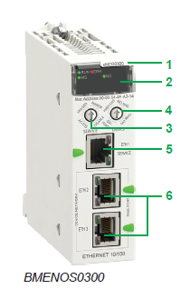

рис.3.5. Зовнішній вигляд BME NOS0300

Модуль BMXNRP0200 (а також BMXNRP0201) у системах на базі M580 виконує функцію перетворювача середовища Ethernet з витої пари на оптоволокно (copper-to-fiber) та використовується для розширення відстаней між пристроями в мережі, особливо у кільцевих топологіях RIO.
Основні особливості BMXNRP:

- BMXNRP0200 підтримує багатомодове волокно на відстань до 2 км,

- BMXNRP0201 — одномодове волокно на відстань до 15 км

Ці модулі встановлюються на стандартне X80-шасі в локальному або віддаленому RIO-стенді та працюють у поєднанні з адаптерами BM•CRA або CPU. Вони не мають логіки комутатора або маршрутизатора, а лише забезпечують прозору ретрансляцію Ethernet-трафіку, подовжуючи фізичний канал на оптоволоконній ділянці. 

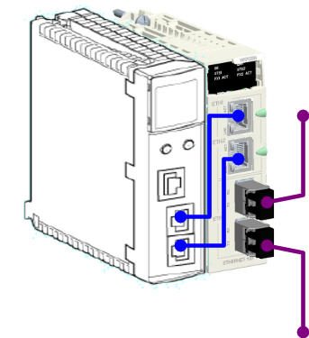

рис.3.6. Зовнішній вигляд BME NRP (праворуч) та підключення до нього модуля NOC (ліворуч) 

### Типова мережна архітектура M580

Типова система M580 спроєктована та протестована для одночасного використання таких компонентів:

- локального шасі з Ethernet та можливістю розширення на інші локальні шасі;
- RIO-вузлів, які підтримують обмін через Ethernet та X-bus по задній шині;
- розподіленого Ethernet-обладнання;
- модулів комутації (network option switch), які з'єднують RIO-вузли та розподілене обладнання з системою M580;
- модуля керуючої мережі (control network module), що забезпечує прозорість між Device Network і Control Network;
- інтеграції RIO та розподіленого обладнання в одну фізичну мережу;
- підкілець RIO і DIO, які обмінюються з головним кільцем RIO;
- модулів та пристроїв сторонніх виробників;
- кільцевих топологій «ланцюжок» (daisy-chain ring), які реалізуються через комунікаційні модулі з двома Ethernet-портами.

Система M580 забезпечує автоматичне відновлення мережі менш ніж за 50 мс та детермінований обмін через RIO. Система використовує модулі вводу/виводу Modicon X80, багато з яких також використовуються в системі M340. Також підтримуються Ethernet-модулі eX80, які можна встановлювати як у головне локальне шасі, так і в головні віддалені стійки. M580 також підтримує модулі вводу/виводу Premium, які встановлюються в розширене локальне шасі. 

Головне кільце (main ring) у типових системах M580 підтримує до 32 пристроїв. До допустимих типів пристроїв належать:

1. локальне шасі, що містить CPU, комунікаційні модулі та модулі вводу/виводу;
2. максимум 31 RIO-вузол, кожен з яких містить адаптер BM•CRA312•0*для мережі EIO.

Модулі BMXNRP020• не враховуються при підрахунку кількості пристроїв у кільці.

Ці обмеження важливі для планування, оскільки перевищення кількості пристроїв може призвести до непередбачуваної поведінки мережі або відмови RIO Scanner. Також важливо враховувати загальну пропускну здатність системи, особливо при великій кількості модулів I/O, частому обміні або змішаних типах трафіку (DIO, SCADA, інженерний доступ). Планування топології кільця має враховувати і кількість портів, і параметри резервування — наприклад, кількість сегментів, довжину ліній, час ART (Application Response Time) та доступність пристроїв після обриву.

На рис.3.7 показана типова багаторівнева структура автоматизованої системи керування, що включає рівні Field ПЛК Modicon M580. 

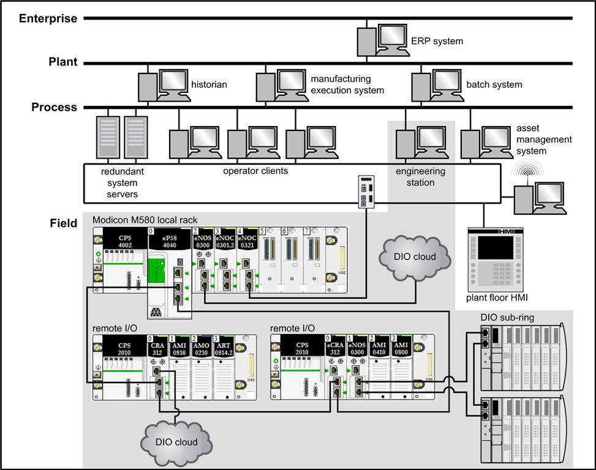

рис.3.7. Типова мережна архітектура M580

У центрі нижньої частини схеми знаходиться локальне шасі Modicon M580, яке формує центральний вузол керування та зв’язку з периферією. До цього центрального вузла підключено два віддалені I/O вузли (remote I/O) через RIO-мережу: Ккожен вузол містить адаптер CRA312 і типові модулі вводу/виводу (наприклад, AMI, AMO). Один із віддалених вузлів пов’язаний із DIO cloud, тобто має підключення до пристроїв, які обмінюються даними через Ethernet без жорсткої синхронізації (наприклад, HMI, приводи, сенсори з Ethernet-інтерфейсом). Інший віддалений вузол підключений до DIO sub-ring — окремої кільцевої мережі розподілених пристроїв, що керується через NOS або інші комутаційні пристрої. На схемі показано, що центральним елементом архітектури є CPU з RIO Scanner, підключений до мережі RIO за топологією кільце. До цього кільця підключаються віддалені стійки вводу/виводу з адаптерами CRA, які забезпечують обмін із модулями вводу/виводу через X-bus. Комунікація між вузлами організована за допомогою безпосередніх з’єднань Ethernet.

У системах на базі Modicon M580 допускається лише один головний вузол керування у межах Device Network — або один автономний контролер (standalone PAC), або одна пара у режимі Hot Standby (основний + резервний). Це обмеження пов’язане з логікою роботи служби RIO Scanner і координації обміну по Ethernet. Якщо у мережі з’явиться два незалежних контролери, кожен з яких спробує керувати RIO або DIO, виникне конфлікт у доступі до вузлів, порушення детермінізму та дублювання керувань, що може призвести до аварійних ситуацій. Це також стосується мереж, побудованих через керовані комутатори або DRS, де, попри фізичне розмежування, логічна мережа є спільною. Отже, у проєктуванні слід чітко забезпечити, що лише один контролер (або одна пара у HSBY) виконує функцію керування пристроями у межах однієї Device Network. Усі інші вузли — лише клієнти, абоненти або пристрої обміну.

Вище розміщено рівень процесного керування, в якому розміщені:

- резервовані системні сервери (Redundant system servers) та операторські клієнти, які взаємодіють з контролером через Control Network, організовану через модулі NOC та спеціальний керований комутатор.
- Інженерні станції (Engineering station) — підключена до цієї ж мережі для конфігурації, оновлення прошивок, моніторингу та діагностики.

* Система керування активами (Asset management system) для обслуговування обладнання.

Вище рівень виробництва (MES (Manufacturing Execution System), Batch System, Historian), а ще вище - підприємства (ERP system), які працюють незалежно від реального часу, однак потребують доступу до даних у процесі.

Ця архітектура демонструє типову побудову розподіленої автоматизованої системи, з ізоляцією логічних і фізичних рівнів, підтримкою DIO, RIO, резервування, а також сегментацією трафіку для надійності та масштабованості. Вона побудована за принципами ISA-95 і IEC 62264, де кожен рівень має свою роль, протоколи і засоби захисту.

### Планування та проєктування типової мережі мережі M580

Планування та проєктування охоплює декілька ключових аспектів: архітектурне планування, вибір типів з’єднань, визначення ролей пристроїв, резервування, та забезпечення детермінізму в обміні. Типова мережа M580 — це повноцінна промислова Ethernet-мережа з інтегрованою підтримкою RIO, DIO, SCADA, HMI, і зв’язків з ІТ-рівнями. Ось основні принципи, які слід врахувати:

1. **Топологія і розташування пристроїв.** Центральним елементом є CPU (ePAC M580), що розміщується в локальному шасі разом із модулями NOC/NOS/NOC0321, NOS0300 та ін. У мережу RIO main ring можуть бути підключені до 31 вузла з адаптерами CRA31200/10. Додатково, через комутатори (наприклад, DRS), можна реалізувати підключення DIO cloud або DIO sub-rings. 

   Зверніть увагу на такі ключові аспекти при виборі топології мережі M580.

   - Відстань між двома суміжними вузлами (drops), а також потенційна потреба у DRS-комутаторах або оптоволоконних перетворювачах BMXNRP020•і волоконно-оптичному кабелі в складі головного кільця. Відстань між двома вузлами (drops) визначає вибір фізичного середовища передачі. Якщо використовується мідний кабель, максимальна відстань між двома суміжними вузлами становить 100 метрів. Якщо відстань перевищує 100 м, слід використовувати один або кілька оптоволоконних перетворювачів BMXNRP020•, щоб конвертувати мідь у оптоволокно. Оптоволоконний кабель, залежно від типу, може сягати до 15 км (для одномодового волокна).
   - Вибір між кільцевою або зірковою топологією (наприклад, DIO cloud у вигляді зірки може взаємодіяти з мережею M580).
   - Конфігурація локального шасі;
   - Вимоги до розподіленого обладнання (distributed equipment);
   - Вимоги до електричної ізоляції, зокрема у випадках, коли локальне шасі та віддалені вузли мають різні системи заземлення. Якщо у мережі необхідна ізоляція (наприклад, коли локальне шасі та RIO-вузли знаходяться на різних системах заземлення), слід використовувати оптоволоконний кабель для з’єднання пристроїв, які підключені до різних контурів заземлення.
   - Вимоги до резервування — для головного кільця і з’єднань із підкільцями (sub-rings).

2. **Сегментація мережі.** Рекомендується виділити принаймні три рівні: Device Network (RIO, DIO), Control Network (SCADA, інженерні станції), і Enterprise Network (MES, ERP). Для ізоляції використовують модулі BMENOC0321 або зовнішні маршрутизатори.

3. **Резервування і відмовостійкість.** У кільцевих топологіях слід застосовувати RSTP або спеціалізовані профілі на комутаторах Schneider (DRS). BMXNRP застосовують для переходу на оптоволокно. Підтримується автоматичне відновлення мережі <50 мс, що важливо для RIO-мереж.

4. **Продуктивність і ART.** Необхідно враховувати пропускну здатність CPU, кількість служб (RIO, DIO, HMI, Modbus TCP, інженерний доступ), максимальну кількість з'єднань через NOC. Слід розрахувати час Application Response Time для критичних сигналів. Кількість одночасних з’єднань TCP/IP залежить від типу підключення до Ethernet-мережі через порт мережного модуля та через вбудований порт CPU. Підключення через вбудований Ethernet-порт CPU (наприклад, для DIO, HMI, інженерного доступу) має власне обмеження на кількість з’єднань, тому при проєктуванні системи важливо розрахувати:

   * скільки HMI, SCADA, сервісів (наприклад, Modbus TCP clients/servers) буде підключено;
   * через який саме інтерфейс вони підключаються;
   * і чи не перевищує це можливості відповідного порту.

   У специфікації зазвичай вказано точні цифри для кожного типу модуля (наприклад, до 64 з’єднань через NOC, але значно менше — через CPU). Якщо потрібно — можу знайти і подати ці обмеження по моделях.

   Таб.3.1. Кількість одночасних підключень для різних комунікаційних каналів.

   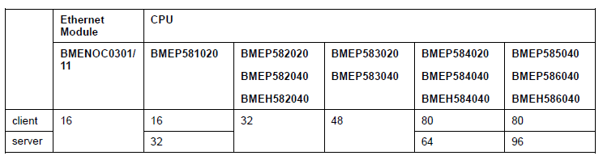

5. **Безпека і керованість.** Вмикання security layer на портах, SNMP, фільтрація служб (DHCP, FTP, HTTP), застосування VLAN та QoS. Встановлення Bridge Priority для RSTP, використання фільтрації широкомовного трафіку.

6. **Масштабування і інтеграція.** Підтримуються Modbus TCP, EtherNet/IP, OPC UA (через окремі шлюзи), доступ з MES/ERP. Передбачено одночасне використання розширених X80 модулів та eX80 Ethernet I/O.

Цей підхід дає змогу побудувати відмовостійку, детерміновану та керовану систему автоматизації, готову до інтеграції з цифровими підприємствами за принципами ISA-95 / IEC 62264. Якщо потрібно — можу оформити це як структуру для розділу проєктної документації.

## Завдання для самостійної роботи

### Варіант 1

Використовуючи рис.3.8 дайте відповіді на наступні питання.

1. Яку роль виконує CPU, позначений як (1), у структурі мережі? Чому важливо, щоб його референс закінчувався на *40?
2. Через який модуль під номером (2) до системи підключено DIO cloud? Чому він встановлений у локальному шасі?
3. Модуль під номером (3) відповідає за керування розподіленим обладнанням. Як він підключається до CPU і які обмеження має щодо кількості підтримуваних пристроїв?
4. Модуль з номером (4) створює прозорість між Device Network і Control Network. У чому його роль і де саме його доцільно застосовувати?
5. Що забезпечує підключення ПК для аналізу трафіку (port mirroring), позначене як (5)? Через який тип порту здійснюється підключення?
6. Модуль під номером (6) розміщено на одному з RIO-вузлів. Для чого він використовується і яку мережеву топологію він обслуговує?
7. DIO cloud підключено через сервісний порт модуля (7). У чому переваги і обмеження такого способу підключення?
8. Як модуль (8) забезпечує з’єднання DIO sub-ring із головним кільцем RIO? Чому для цього використовується саме BMENOS0300?
9. Яку максимальну кількість пристроїв може сканувати один модуль BMENOC0301(C)/0311? Як це впливає на планування мережі?
10. У яких випадках доцільно відключати Ethernet backplane на комунікаційних модулях, таких як NOC або NOS?

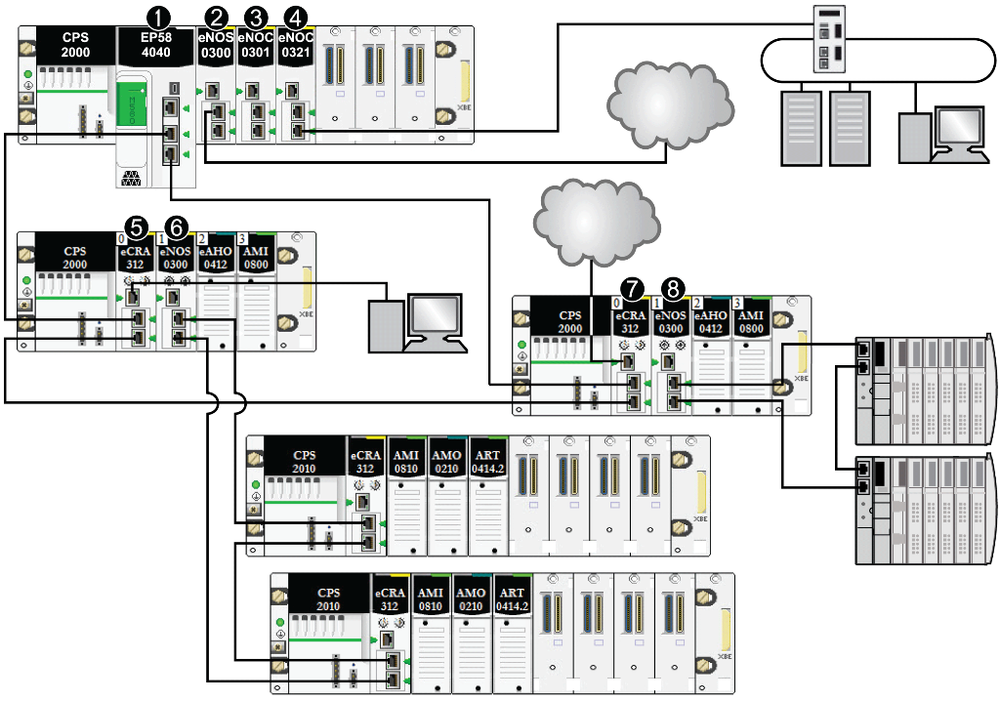

рис.3.8. Структурна схема системи

Таблиця 3.2. Позначення на схемі

| Номер | Назва                                                  | Примітка |
| ----- | ------------------------------------------------------ | -------- |
| 1     | M580 CPU with Ethernet I/O scanner service             |          |
| 2     | BMENOS0300 network option switch module                |          |
| 3     | BMENOC0301(C)/BMENOC0311 Ethernet communication module |          |
| 4     | BMENOC0321(C) control network module                   |          |
| 5     | сервісний порт в режимі дзеркалювання                  |          |
| 6     | BMENOS0300                                             |          |
| 7     | BMECRA31210 eX80                                       |          |
| 8     | BMENOS0300 network option switch module                |          |

### Варіант 2

Використовуючи рис.3.9 дайте відповіді на наступні питання.

1. Яку функцію виконує CPU з позначкою (1) у складі мережі? Який тип сервісу він забезпечує та яка умова має бути виконана для його підтримки?
2. Для чого використовується модуль BMENOS0300 під номером (2)? Який тип топології він обслуговує, і як пов’язаний з головним кільцем?
3. Яку роль у мережі виконує модуль BMENOC0321 (позначка 3)? Які два логічні сегменти мережі він пов’язує?
4. На RIO-вузлі з позначкою (4) встановлено BMENOS0300. Яку топологічну функцію він реалізує? Чому для цього використано саме цей модуль?
5. Модуль із позначкою (5) також є BMENOS0300, але на іншому RIO-вузлі. Чим функціонально відрізняється його роль від модуля з позначкою (4), якщо врахувати прив’язку до інших елементів мережі?
6. Скільки DIO sub-ring сегментів зображено на схемі? Через які модулі та в яких місцях вони інтегровані до RIO main ring?
7. Яка топологія використовується між нижніми RIO-вузлами? Чи має така побудова резервування? Якими засобами воно забезпечується?
8. У яких вузлах встановлені модулі аналогового виходу (AMO)? Як ці сигнали потрапляють до системи керування?
9. Як на схемі реалізовано розмежування між Device Network та Control Network? Які модулі або сегменти відповідають за ізоляцію?
10. Чи присутні в системі фізично або логічно ізольовані DIO cloud? Якщо ні, чим відрізняється така побудова від попереднього варіанта (рис. 3.8)?

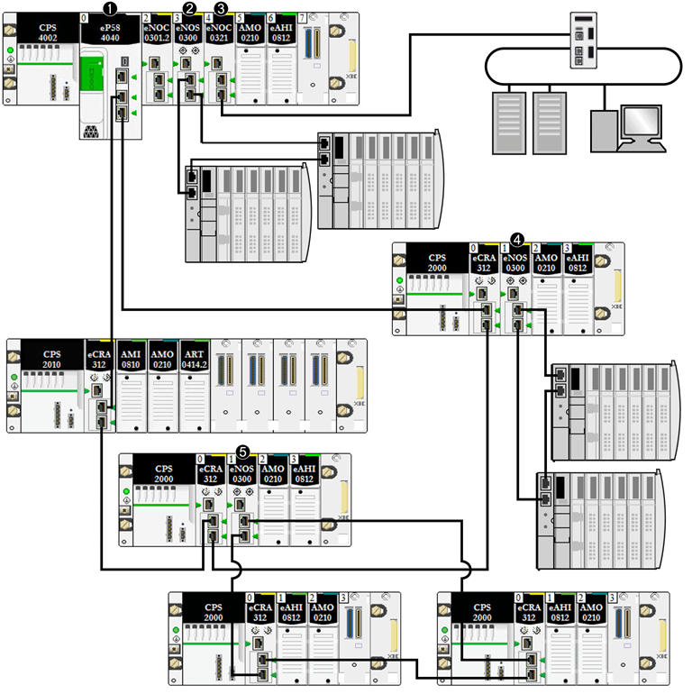

рис.3.9. Структурна схема системи

Таблиця 3.3. Позначення на схемі

| Номер | Назва                                      | Примітка |
| ----- | ------------------------------------------ | -------- |
| 1     | M580 CPU with Ethernet I/O scanner service |          |
| 2     | BMENOS0300 network option switch module    |          |
| 3     | BMENOC0321                                 |          |
| 4     | BMENOS0300                                 |          |
| 5     | BMENOS0300                                 |          |

### Варіант 3

Використовуючи рис.3.10 дайте відповіді на наступні питання.

1. Яку роль виконує CPU, позначений як (1)? Який сервіс у ньому активовано, і які умови потрібно врахувати при виборі моделі CPU?
2. Чим відрізняється модуль BMENOC0301/0311 з позначкою (2) від модуля під номером (3) у цій схемі? Що означає "відключене з’єднання через Ethernet-backplane" та як це впливає на обмін із CPU?
3. Як модуль під номером (3) реалізує сканування розподіленого обладнання (distributed equipment)? Яке обмеження накладається на кількість пристроїв?
4. Яку функцію виконує модуль з позначкою (4)? Які сегменти мережі він логічно пов’язує, і яку користь дає таке розділення?
5. Скільки віддалених RIO-вузлів представлено на схемі? Через які модулі (позначка 5) вони інтегровані в головне кільце?
6. Яким чином DIO cloud, позначена як (6), підключена до системи? Через який порт і модуль здійснюється це підключення?
7. У якому з вузлів реалізовано DIO-хмару, ізольовану від Ethernet-backplane? Чим зумовлений такий підхід?
8. Яка топологія застосована для з’єднання між вузлами? Чи є резервування?
9. В яких точках мережі можливе конфліктне дублювання сканування, якщо неправильна конфігурація модулів NOC?
10. Чому важливо чітко вказати, у яких модулях увімкнене або вимкнене з’єднання по backplane? Як це впливає на передавання даних до CPU?

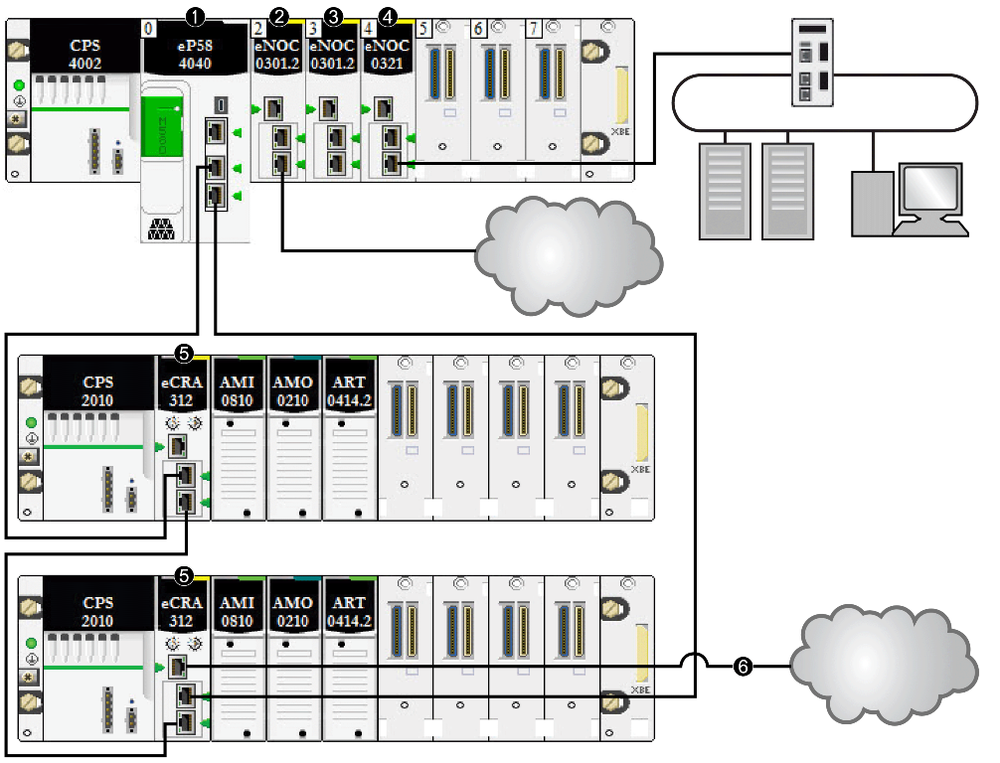

рис.3.10. Структурна схема системи

Таблиця 3.4. Позначення на схемі

| Номер | Назва                                      | Примітка |
| ----- | ------------------------------------------ | -------- |
| 1     | M580 CPU with Ethernet I/O scanner service |          |
| 2     | BMENOC0301                                 |          |
| 3     | BMENOC0301                                 |          |
| 4     | BMENOC0321                                 |          |
| 5     | BMENOS0300                                 |          |
| 6     | BM•CRA31210                                |          |

### Варіант 4

Використовуючи рис.3.11 дайте відповіді на наступні питання.

1. Яку функцію виконує модуль у позиції 3 локального шасі? Які два логічні рівні мережі він пов’язує і чому його використовують саме у цій точці?
2. Через який модуль (вказати позицію в шасі) здійснюється підключення DIO daisy chain, позначеного як зв’язок (2)? У чому особливість такої топології?
3. Яке з’єднання показане як (3)? До яких портів належить це підключення, і чи забезпечується в ньому резервування? Які умови необхідні для його коректної роботи?
4. Який модуль у віддаленому вузлі (вказати позицію в шасі) обслуговує підключення DIO sub-ring, позначеного як (4)? Як ця частина пов’язана з основним RIO кільцем?
5. Яка кількість вузлів бере участь у кільці, утвореному між нижніми шасі? Чи забезпечується апаратне резервування в такій конфігурації?
6. Як розподіляється трафік між CPU (встановлений у позиції 1 локального шасі) та DIO-вузлами? Через які модулі здійснюється передача?
7. У яких позиціях шасі встановлено аналогові модулі (`AMI`, `AMO`, `EAHO`, `ART`)? Як розподілені їхні функції між вузлами?
8. Які з’єднання в цій схемі потенційно вимагають активного використання RSTP? Чому?
9. Яким чином досягнуто гальванічну ізоляцію між різними сегментами мережі, якщо така передбачена? Чи є у схемі ознаки електричного розмежування?
10. Враховуючи загальну структуру, як ти оціниш цю мережу: як централізовану, розподілену чи змішану? Наведи аргументи з прикладу.

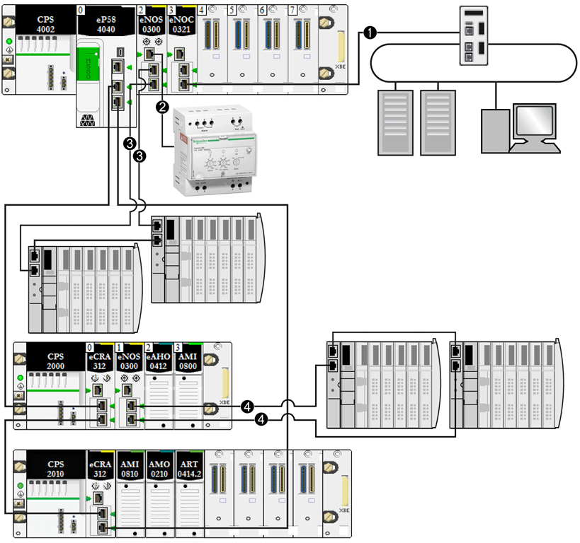

рис.3.11. Структурна схема системи

Таблиця 3.5. Позначення на схемі

| Номер | Назва                                                        | Примітка |
| ----- | ------------------------------------------------------------ | -------- |
| 1     | Модуль BMENOC0321 на локальній стійці забезпечує прозорість між мережею пристроїв та мережею керування. |          |
| 2     | Модуль BMENOS0300 на локальній стійці підключено до DIO через ланцюжок. |          |
| 3     | Той самий модуль BMENOS0300 на локальній стійці підключено до ланцюжкового підключення DIO. |          |
| 4     | Модуль BMENOS0300 на відгалуженні (e)X80 підключено до підкільця DIO. |          |

### Варіант 5

Використовуючи рис.3.12 дайте відповіді на наступні питання.

1. Яку функцію виконує модуль, встановлений у позиції 4 локального шасі? Які дві логічні мережі він з’єднує?
2. Через які модулі (вказати позиції у шасі) реалізовано з’єднання, позначене як (2)? Який тип топології воно формує?
3. Що зображено під позначкою (3)? Як воно з’єднане з іншими вузлами, і яку структуру формує?
4. Які вузли підключено через з’єднання (4)? Скільки таких з’єднань присутнє і як забезпечується передача даних до CPU?
5. У яких позиціях встановлені модулі BMENOS0300? Як розподілені їх функції?
6. У якому вузлі реалізовано розширене аналогове введення/виведення? Які модулі використовуються і які їх позиції?
7. У яких частинах схеми передбачене резервування або зменшення точки відмови? Яким чином це реалізовано або не реалізовано?
8. Чи можливо використання такої архітектури в режимі Hot Standby? Чому?
9. Які з’єднання критично залежать від наявності RSTP на вузлах? Який механізм може забезпечити відновлення при обриві?
10. Які особливості побудови DIO daisy chain роблять таку архітектуру чутливою до помилок? Які засоби покращення надійності можна застосувати?

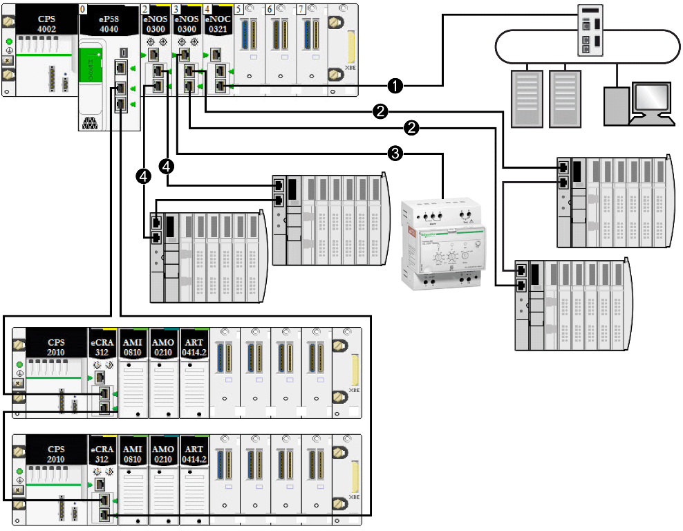

рис.3.12. Структурна схема системи

Таблиця 3.6. Позначення на схемі

| Номер | Назва                                                        | Примітка |
| ----- | ------------------------------------------------------------ | -------- |
| 1     | Модуль BMENOC0321 на локальній стійці забезпечує прозорість між мережею пристроїв та мережею керування. |          |
| 2     | Модуль BMENOS0300 на локальній стійці підключено до DIO через ланцюжок. |          |
| 3     | Той самий модуль BMENOS0300 на локальній стійці підключено до петлі ланцюгового з'єднання DIO. |          |
| 4     | Інший модуль BMENOS0300 на локальній стійці підключено до іншого ланцюгового з'єднання DIO. |          |

### Варіант 6

Використовуючи рис.3.13 дайте відповіді на наступні питання.

1. Який модуль встановлений у позиції 1 локального шасі? Який сервіс він забезпечує, і яку умову потрібно виконати, щоб його можна було використовувати як Ethernet I/O Scanner?
2. У якій позиції шасі встановлено оптоволоконний перетворювач BMXNRP0200, позначений як (2)? Яку функцію він виконує, та чому використовується саме в цій точці?
3. Які два рівні мережі пов’язує модуль у позиції 5 локального шасі? Чому саме його застосовують для створення прозорості між Device Network і Control Network?
4. Що позначає лінія під номером (4)? Яка її топологічна роль у системі? Скільки сегментів кільця показано та скільки вузлів воно включає?
5. Яку довжину мають відрізки Ethernet між вузлами кільця (позначені як 4)? Чи відповідають вони вимогам до максимальної довжини для мідного Ethernet? Яка лінія перевищила допустиму довжину для мідного з’єднання?
6. Чому в системі застосовано BMXNRP0200? На якій ділянці його встановлено, і яку довжину з'єднання він дозволяє подолати?
7. Скільки вузлів підключено до RIO main ring (позначення 5)? Чи не перевищено ліміти архітектури M580 щодо кількості CRA?
8. Які типи модулів вводу/виводу встановлені у RIO drop-вузлах? У яких позиціях вони знаходяться, і як пов’язуються з CPU?
9. Які обмеження потрібно врахувати при використанні довгих з'єднань у RIO кільцях? Які альтернативи доступні при перевищенні меж?
10. Як зміна довжини міжвузлового з’єднання впливає на час Application Response Time (ART) і чи потрібно це враховувати в проєктуванні?

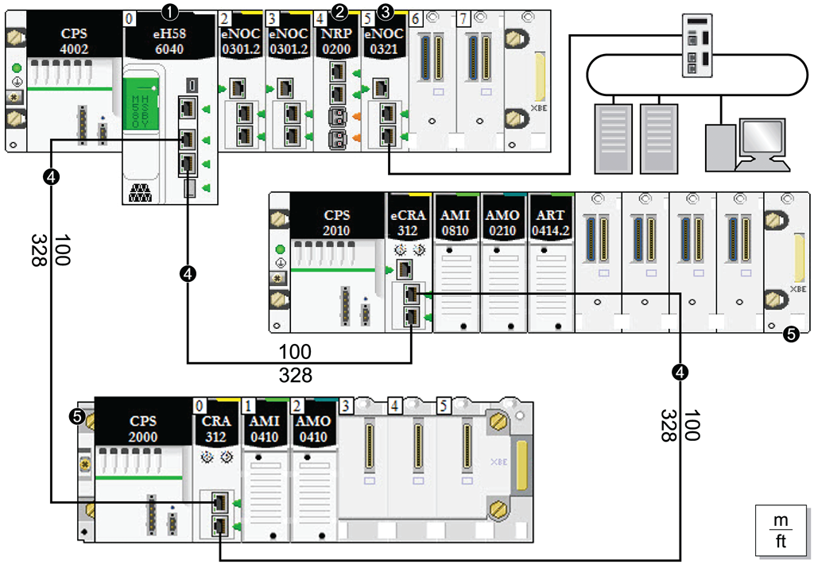

рис.3.13. Структурна схема системи

Таблиця 3.7. Позначення на схемі

| Номер | Назва                                                        | Примітка |
| ----- | ------------------------------------------------------------ | -------- |
| 1     | M580 CPU with Ethernet I/O scanner service                   |          |
| 2     | Модуль оптоволоконного перетворювача BMXNRP020•              |          |
| 3     | Модуль BMENOC0321 на локальній стійці, що забезпечує прозорість між мережею пристроїв та мережею керування |          |
| 4     | Головне кільце                                               |          |
| 5     | Відведення RIO (включаючи модуль адаптера BM•CRA312•0 X80 EIO) на головному кільці |          |

### Варіант 7

Використовуючи рис.3.14 дайте відповіді на наступні питання.

1. Який модуль встановлено у позиції 1 локального шасі? Яку роль він відіграє в побудові RIO main ring?
2. У якій позиції розміщено перший модуль BMXNRP020• (позначка 2)? Чому він встановлений саме там, і які функції виконує?
3. Яку частину мережі позначено пунктирною лінією (позначка 3)? Який тип середовища передачі вона представляє, і яку максимальну відстань забезпечує?
4. Які переваги має застосування оптоволокна в кільцях RIO на відстані понад 100 м? Які ризики усуваються?
5. Яку частину мережі позначено суцільною лінією (позначка 4)? Які обмеження існують для такого типу з'єднання?
6. У яких вузлах встановлені BMXNRP020• модулі з позначкою 5? Як вони підключені до головного кільця, і через які порти?
7. У яких вузлах реалізовано підключення через мідь і оптоволокно одночасно (позначка 6)? Чому так зроблено?
8. Які модулі вводу/виводу використовуються на RIO drop-вузлах? У яких позиціях вони встановлені, і як пов’язані з CRA?
9. Які лінії в схемі мають довжину 1000 м? Який тип кабелю допустимий на такій відстані?
10. В яких частинах кільця забезпечено резервування з урахуванням використаних середовищ? Як це впливає на надійність системи при фізичних пошкодженнях?

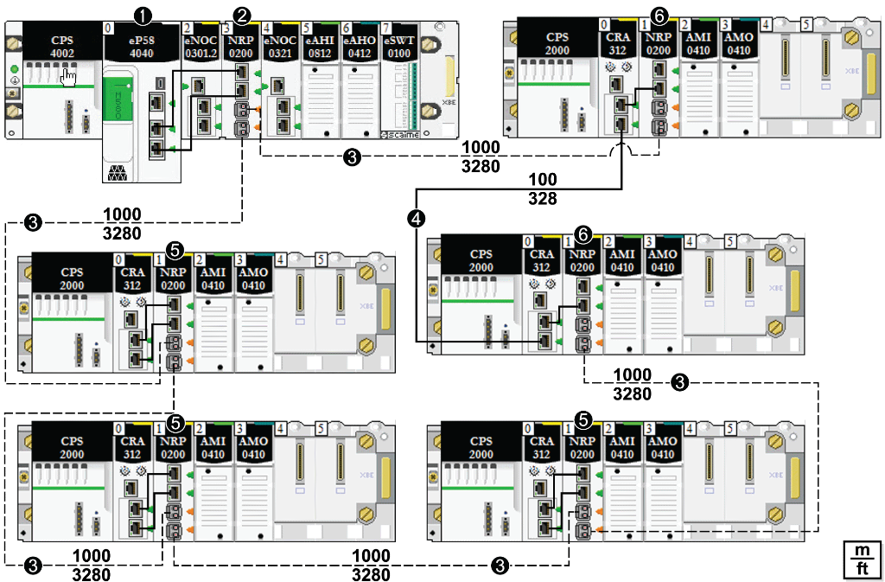

рис.3.14. Структурна схема системи

Таблиця 3.8. Позначення на схемі

| Номер | Назва                                                        | Примітка |
| ----- | ------------------------------------------------------------ | -------- |
| 1     | M580 CPU with Ethernet I/O scanner service                   |          |
| 2     | Модуль оптоволоконного перетворювача BMXNRP020•              |          |
| 3     | Оптоволоконна ділянка головного кільця                       |          |
| 4     | Мідна ділянка головного кільця                               |          |
| 5     | Перетворювач на RIO drop, з'єднаний із кільцем через волокно |          |
| 6     | Перетворювач на RIO drop, з'єднаний одночасно через мідь і волокно |          |

### Варіант 8

Використовуючи рис.3.15 дайте відповіді на наступні питання.

1. Яку функцію виконує CPU в позиції 0 (позначка 1) локального шасі? Яким чином він взаємодіє з RIO main ring?
2. Скільки модулів BMENOC0301(C) встановлено у локальному шасі (позначка 2)? Для чого вони використовуються, і які обмеження щодо кількості пристроїв?
3. Яку роль виконує модуль у позиції 3 (позначка 3)? Які мережі він пов’язує?
4. Що позначає з’єднання під номером 4? Який рівень системи підключається до нього?
5. Яку топологію формують з’єднання з позначкою 5? Скільки вузлів входить до RIO main ring і як забезпечується його замкненість?
6. Яка роль модулів CRA312, позначених як 6, у складі віддалених вузлів?
7. Як модуль BMENOS0300 у позиції 7 взаємодіє з іншими DIO-компонентами?
8. Як DIO cloud (позначка 8) інтегрована до системи? Через який вузол і модуль?
9. Що таке STB island, позначена як 9? Як вона відрізняється від інших DIO-вузлів?
10. Які особливості проєктування слід врахувати при одночасному використанні DIO cloud і STB island у складі одного RIO кільця

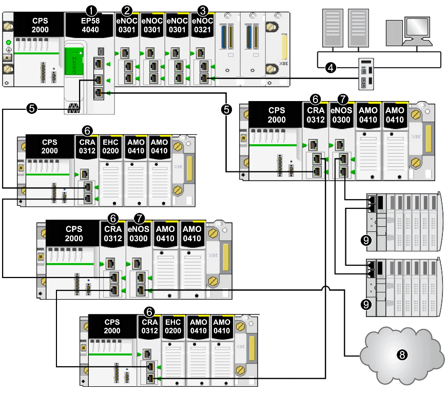

рис.3.15. Структурна схема системи

Таблиця 3.9. Позначення на схемі

| Номер | Назва                                                        | Примітка |
| ----- | ------------------------------------------------------------ | -------- |
| 1     | M580 CPU with Ethernet I/O scanner service                   |          |
| 2     | Модуль зв'язку Ethernet BMENOC0301(C)/BMENOC0311, що керує розподіленим обладнанням у мережі пристроїв |          |
| 3     | Модуль мережі керування BMENOC0321(C), що забезпечує прозорість між мережею керування та мережею пристроїв |          |
| 4     | мережа керування                                             |          |
| 5     | Головне кільце RIO                                           |          |
| 6     | Модуль адаптера EIO BM•CRA312•0 (e)X80 на відгалуженні RIO на головному кільці |          |
| 7     | Модуль BMENOS0300 на відгалуженні RIO                        |          |
| 8     | Хмара DIO, підключена до головного кільця через модуль комутатора мережевих опцій BMENOS0300 на відгалуженні RIO |          |
| 9     | Острів STB у підкільці DIO, підключений до головного кільця через модуль BMENOS0300 на відгалуженні RIO |          |

## Питання для самоконтролю знань

1. Яка головна відмінність між DIO та RIO в архітектурі M580?
2. Які основні переваги використання кільцевої топології в промисловому Ethernet?
3. Що таке служба RIO Scanner і які CPU її підтримують?
4. Який тип комунікацій має жорсткий зв’язок із циклом задач MAST?
5. У яких випадках використовується служба DIO Scanner?
6. Як визначається пріоритет між DIO і RIO у системі M580?
7. Який стандарт протоколу резервування найчастіше використовується в RIO кільцях?
8. Чим відрізняється RSTP від MRP?
9. Що таке Device Network і як вона пов’язана з CPU M580?
10. Чому некеровані комутатори не можуть використовуватись у кільцевих топологіях?
11. Яку максимальну довжину підтримує витa пара в RIO мережі?
12. У яких випадках доцільно використовувати оптоволоконне з’єднання?
13. Які модулі використовуються для переходу з міді на оптоволокно?
14. Що таке BMXNRP0200 і яку максимальну відстань він підтримує?
15. Які топології підтримуються для підключення DIO пристроїв?
16. Яка різниця між DIO sub-ring та DIO daisy chain?
17. Які переваги має використання керованих комутаторів типу NOS?
18. Як активується резервування в модулях BMENOS0300?
19. Чи може один і той самий порт CPU підтримувати і RIO, і DIO?
20. Що таке Ethernet backplane в шасі M580 і які модулі ним користуються?
21. Які компоненти обов’язково входять у головне кільце RIO?
22. Які фактори впливають на обмеження кількості TCP/IP з’єднань в системі M580?
23. Що таке служба QoS і як вона реалізується в промисловій мережі?
24. Для чого використовується SNMP в індустріальних комутаторах?
25. Як забезпечити безпечне прокладання екранованого Ethernet-кабелю в промисловому середовищі?
