# Практичне заняття 4. Проектування мереж Modbus TCP/IP

## Основні теоретичні відомості

### Загальні підходи до проєктування Modbus TCP/IP

У контексті проєктування мережі Modbus TCP/IP важлива послідовність рішень, які приймає інженер для реалізації стабільної та сумісної мережі. Нижче наведено типовий порядок проєктування такої мережі:

1. **Визначення ролей вузлів (клієнт/сервер).** Modbus TCP працює за моделлю клієнт–сервер, тобто:

- Клієнт (часто називаються master як і в Modbus RTU) ініціює запити — зазвичай SCADA, MES, HMI, або один із контролерів.
- Сервери (часто називаються slave як і в Modbus RTU) — пристрої, які обслуговують ці запити: ПЛК, модулі вводу/виводу, приводи, шлюзи.

На цьому етапі визначаються всі учасники обміну та ті, що потребують прямого доступу до інших пристроїв. На відміну від Modbus RTU, в Modbus TCP/IP вузли (пристрої, застосунки) можуть бути як клієнтами так і серверами одночасно в одній мережі. 

2. **Визначення логіки обміну (архітектури запитів).** Потрібно спроєктувати:

- Які саме дані має опитувати клієнт (тобто, які регістри читати/записувати);
- З якою періодичністю (частота опитування);
- Обсяг даних (щоб уникати надмірного навантаження).

Це впливає на розрахунок трафіку та формування карти регістрів (Modbus map).

3. **Вибір фізичної та логічної топології.** Modbus TCP — це IP-мережа, отже тут вирішується усі питання пов'язані з проектуванням Ethernet та TCP/IP. Зокрема розподіл IP-адрес та адресація пристроїв, доступ до портів, безпекові заходи і т.п.

5. **Вибір обладнання та програмного забезпечення**. На цьому етапі підбирається:

- Комунікаційне обладнання: Ethernet-комутатори (керовані/некеровані), маршрутизатори;
- Вузли з підтримкою Modbus TCP;
- Програмні компоненти: драйвери для SCADA, шлюзи (наприклад, Modbus RTU ↔ TCP), OPC-сервери, тощо.

6. **Проєктування конфігурації пристроїв**. 

- Встановлення параметрів Modbus TCP на кожному вузлі: порт (502), дозволені IP-клієнти, timeout, час очікування, кількість з’єднань;
- Визначення Modbus-відображення: адреси регістрів, їх значення, типи (Coils, Inputs, Holding Registers).

8. **Документування архітектури.** Документування може включати:

- Структурні та топологічні схеми;
- Таблиці адрес;
- Перелік пристроїв;
- Налаштування комунікаційних параметрів;
- План тестування та налагодження.

У різних ПЛК, панелях, edge-контролерах підтримка Modbus TCP реалізована по-різному. Важливо перевірити не лише наявність підтримки протоколу, а й спосіб її реалізації: 

- Чи може ПЛК бути Modbus TCP клієнтом? Багато контролерів (особливо бюджетних) підтримують лише серверну (slave) роль.

- Чи можлива багатопотоковість або кілька клієнтів? Деякі ПЛК/SCADA не підтримують одночасну обробку кількох TCP-з’єднань, усі мають обмеження на кількість одночасних з'єднань.

- Як налаштовується відображення (Modbus Mapping)? В деяких пристроях вона фіксована (наприклад, Modbus address = physical memory offset), в інших — конфігурується.
- Як реалізовано клієнт або сервер? Це може бути як прошивка (апаратний рівень, швидка реакція), програмна бібліотека (повільніше, залежить від циклу програми), окремий сервіс ОС (на edge-пристроях або ПЛК з Open Linux).

Помилка на цьому етапі може зробити реалізацію неможливою або неефективною — наприклад, якщо всі пристрої підтримують тільки серверну роль, доведеться міняти апаратуру або вводити додатковий шлюз.

### Шлюзування Modbus TCP/IP

У складених системах часто виникає потреба інтегрувати пристрої, які підтримують тільки послідовний Modbus RTU або ASCII, у мережу Modbus TCP. У такому випадку необхідно передбачити шлюзи протоколів. Вони виконують трансляцію протоколу без зміни логіки обміну (тобто зберігається клієнт-серверна модель, адресація, функції Modbus). При шлюзування використовується адреса кінцевого пристрою `UnitID`

Приклади шлюзування:

- TCP-клієнт → RTU-slave: клієнт звертається по TCP/IP, шлюз передає кадр в послідовну лінію до RTU-пристрою.
- RTU-клієнт → TCP-сервер: клієнт з Modbus RTU ініціює запити, шлюз звертається до TCP-сервера (наприклад, іншого ПЛК).
- SCADA з одним клієнтом обслуговує кілька RTU-шин через окремі шлюзи, які зберігають логіку адресації (наприклад, Advantech ADAM, Moxa, ICP DAS).

Під час проєктування слід:

- передбачити шлюзи, що підтримують таблицю відображення адрес (mapping), щоб уникнути конфліктів;
- оцінити затримки при транзиті через шлюз (особливо в поєднанні з повільною RTU-шиною);
- вибрати, де реалізувати відображення регістрів — на шлюзі чи в кінцевих пристроях;
- перевірити, чи шлюз підтримує багатопотоковість і одночасні TCP-з’єднання.

Шлюзування протоколів не є універсальним, тому під час проєктування необхідно ретельно вивчити документацію шлюзів, а в складних випадках — використовувати edge-контролери з повноцінною підтримкою обох протоколів і логікою трансляції на рівні застосунку.

Для коректного проєктування мережі з шлюзом Modbus TCP/RTU необхідно розрізняти типи шлюзів за алгоритмом роботи, оскільки це впливає на сумісність, надійність і логіку обміну. Типи шлюзів Modbus TCP ↔ RTU за алгоритмом роботи:

1. Прозорий шлюз (transparent gateway). Перетворює запити Modbus TCP на Modbus RTU без зміни змісту PDU. З TCP-запиту відкидається MBAP-заголовок, Unit ID використовується як RTU-адреса, тіло (function code + data) передається у RTU-інтерфейс з додаванням CRC. В зворотному напрямку RTU-відповідь інкапсулюється в TCP-запит із відновленням MBAP. Переваги: мінімальні затримки, проста логіка. Обмеження: підтримка одного TCP-клієнта, відсутність маршрутизації
2. Шлюз з адресним відображенням (address mapping gateway). Виконує роль TCP-сервера і RTU-клієнта. Обробляє запит локально, потім створює новий RTU-запит і надсилає його до відповідного пристрою згідно з внутрішньою таблицею відповідності Unit ID ↔ RTU-адреса. Переваги: підтримка кількох клієнтів і декількох RTU-пристроїв, можливість маршрутизації. Обмеження: потреба в конфігурації відображення (наприклад через Веб-інтерфейс).
3. Мультиплексний шлюз (multiplexing gateway). Приймає запити від кількох TCP-клієнтів, керує чергою запитів, послідовно обслуговуючи їх через один або кілька RTU-інтерфейсів. Забезпечує взаємну ізоляцію сесій. Переваги: підтримка кількох клієнтів одночасно. Обмеження: потребує точного налаштування тайм-аутів, збільшує латентність. 
4. Реверсивний шлюз (reverse gateway). Працює у зворотному напрямку: контролер або інший пристрій із RTU-інтерфейсом виступає як master, а шлюз формує відповідні TCP-запити до серверів у мережі Modbus TCP. Переваги: дає змогу RTU-клієнту працювати з TCP-серверами. Обмеження: не всі шлюзи це підтримують, складніша конфігурація

Ця класифікація є важливою для правильного вибору шлюзу в архітектурі КІСК, залежно від кількості клієнтів, потреби у трансляції адрес, типу підключених пристроїв і підтримки паралельного обміну.

### Загальні підходи до проєктування OPC-взаємодії

У контексті КІСК проєктування з використанням OPC DA або OPC UA не виділено як окрема методика, але інтегрується у загальний системно-інженерний підхід. Нижче наведено типовий порядок дій із урахуванням специфіки кожного стандарту.

1. Формування вимог (технічне завдання). 

- Означити потреби щодо взаємодії між системами (наприклад, SCADA ↔ PLC, SCADA ↔ MES).
- Визначити, чи потрібна підтримка історичності, структурованих даних, типізації, безпеки, клієнтів на різних платформах — якщо так, OPC UA є пріоритетом.
- У випадку використання старих систем або потреби у швидкій інтеграції — OPC DA.

2. Вибір архітектури інтеграції

- Для OPC UA: обирається Client/Server або PubSub модель (напр. SCADA → OPC UA Client).
- Для OPC DA: архітектура завжди Client/Server, лише COM/DCOM (Windows only).
- Якщо є edge-шлюзи, слід передбачити транзитні шляхи (наприклад, OPC DA → OPC UA конвертер).

3. Визначення інформаційної моделі

- Побудова тег-структури: що буде публікуватися, які типи даних, їх групування.
- Для OPC UA бажано формувати Nodeset-модель, із типами об'єктів, змінними, методами, ієрархією.

4. Конфігурація програмно-технічних засобів

- Розгортання OPC-серверів: на яких вузлах, які пристрої вони обслуговують.
- Вказання точок обміну: ідентифікатори змінних, інтерфейси, доступ.
- Уточнення параметрів з'єднання: частота, deadband, оновлення, механізм доступу.

5. Безпека та ізоляція

- OPC UA: настроювання сертифікатів, політик шифрування, користувачів, прав доступу.
- OPC DA: налаштування DCOM, фаєрволів, імен користувачів на серверах.
- Розподіл зон обміну і доступу відповідно до принципів IEC 62443.

6. Тестування та валідація

- Верифікація правильності обміну: чи відповідають теги очікуваним значенням, чи оновлюються.
- Імітація збоїв з перевіркою реакції: обриви, втрати, перекручення даних.

7. Документування

- Опис потоків даних (тег → джерело → споживач).
- Модель інформаційного потоку, що включає: протокол, драйвер, напрямок, частоту, відповідального, обмеження.
- Таблиці трасування тегів, сценаріїв використання, зон відповідальності.

## Завдання для самостійної роботи

Модернізувати існуючу систему, структурна схема якої наведена на рис.1, згідно поставленого на графовій моделі інформаційних потоків (рис.2.) завдання. За умов наведених в таблиці під рисунками: 

- перші дві колонки - можливість використання додаткових комунікаційних каналів
- 3-5 колонки - підтримувані інтерфейси (наявні комунікаційні драйвери)   

Для модернізованої системи навести:

1. Розширену структурну схему КТС системи;
2. Схему інформаційної структури.

### Варіант №1

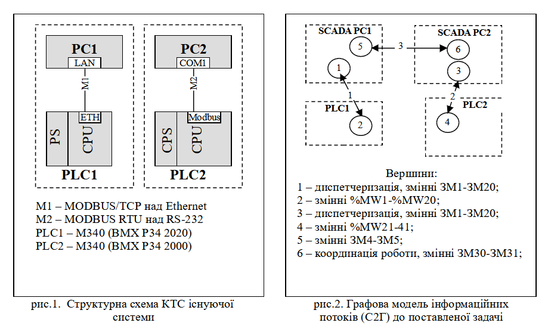

| PLC1            | PLC2            | SCADA PC1                                      | SCADA PC2                                     |      |
| --- | --- | ---- | --- | ---- |
| не допускається | не допускається | OPC Client   OPC Server   MODBUS/TCP | OPC Client   OPC Server  MODBUS RTU |      |

### Варіант №2

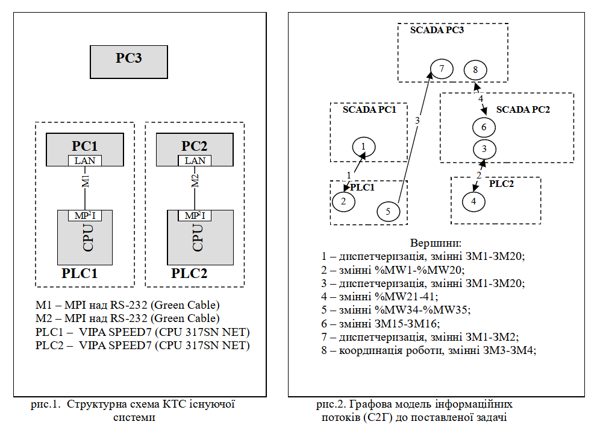

| PLC1                         | PLC2                         | SCADA PC1             | SCADA PC2                                                    | SCADA PC3  |
| ---- | ---- | --- |  | ---- |
| допускаються вбудовані в CPU | допускаються вбудовані в CPU | MPI (S7 PG/OP Serial) | OPC Client   OPC Server   MPI (S7 PG/OP Serial)  S7 PG/OP TCP/IP | OPC Client |

### Варіант №3

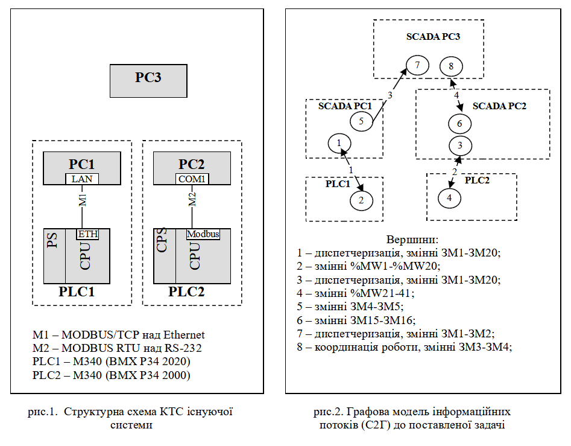

| PLC1            | PLC2            | SCADA PC1                                      | SCADA PC2                                     | SCADA PC3                                                    |
| --- | --- | ---- | --- |  |
| не допускається | не допускається | OPC Client   OPC Server   MODBUS/TCP | OPC Client   OPC Server  MODBUS RTU | OPC Client   OPC Server   MODBUS/TCP   MODBUS RTU |

### Варіант №4

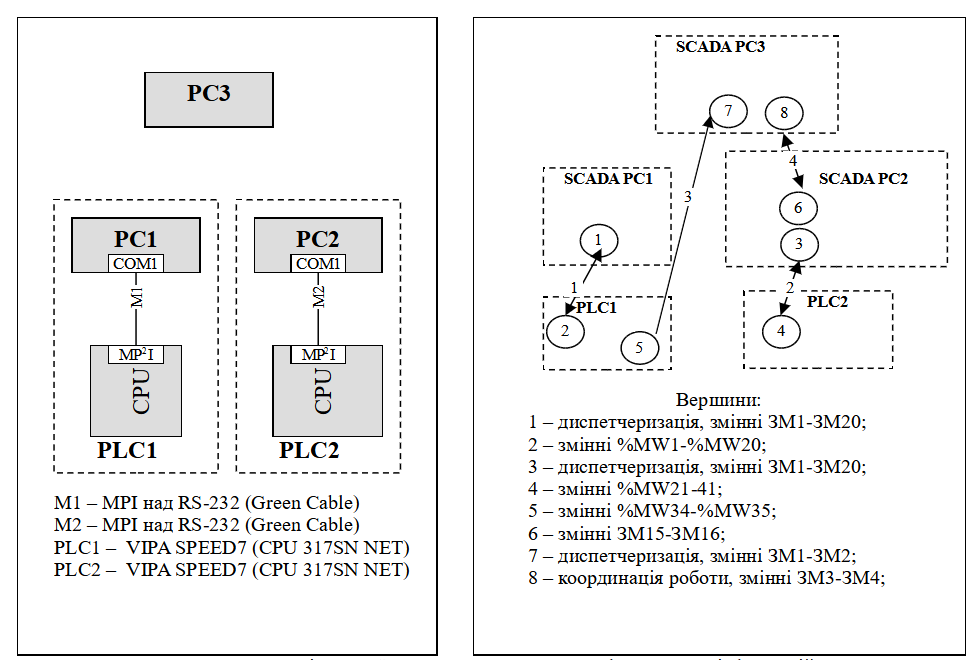

| PLC1                         | PLC2                         | SCADA PC1                              | SCADA PC2                                                    | SCADA PC3                                                    |
| ---- | ---- | -- |  |  |
| допускаються вбудовані в CPU | допускаються вбудовані в CPU | MPI (S7 PG/OP Serial)  S7 PG/OP TCP/IP | OPC Client   OPC Server   MPI (S7 PG/OP Serial)  S7 PG/OP TCP/IP | OPC Client   OPC Server   MPI (S7 PG/OP Serial)  S7 PG/OP TCP/IP |

### Варіант №5

| PLC1            | PLC2            | SCADA PC1                                      | SCADA PC2                                     | SCADA PC3                                                    |
| --- | --- | ---- | --- |  |
| не допускається | не допускається | OPC Client   OPC Server   MODBUS/TCP | OPC Client   OPC Server  MODBUS RTU | OPC Client   OPC Server   MODBUS/TCP   MODBUS RTU |

### Варіант №6

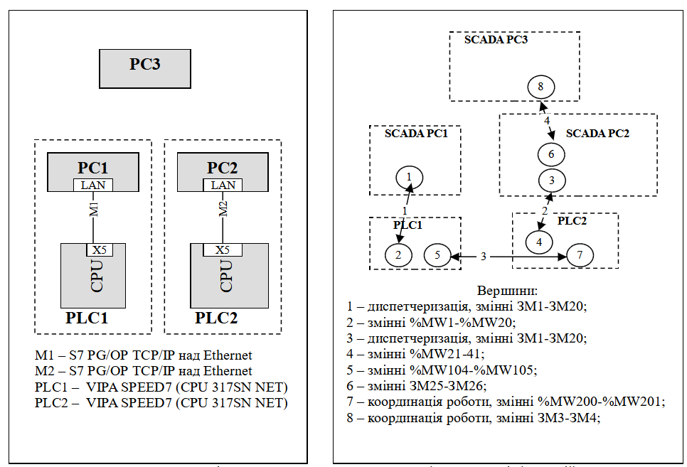

| PLC1                         | PLC2                         | SCADA PC1                                           | SCADA PC2                                          | SCADA PC3                                          |
| ---- | ---- | --- | -- | -- |
| допускаються вбудовані в CPU | допускаються вбудовані в CPU | OPC Client   OPC Server   S7 PG/OP TCP/IP | OPC Client   OPC Server  S7 PG/OP TCP/IP | OPC Client   OPC Server  S7 PG/OP TCP/IP |

### Варіант №7

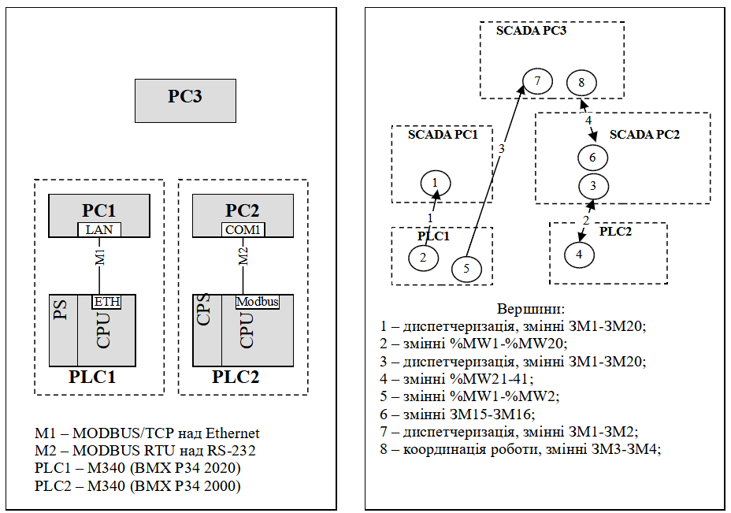

| PLC1            | PLC2            | SCADA PC1                                      | SCADA PC2                                     | SCADA PC3                    |
| --- | --- | ---- | --- | ---- |
| не допускається | не допускається | OPC Client   OPC Server   MODBUS/TCP | OPC Client   OPC Server  MODBUS RTU | OPC Client   OPC Server |

### Варіант №8

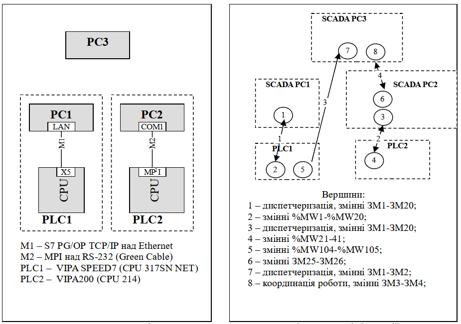

| PLC1            | PLC2            | SCADA PC1                                           | SCADA PC2                                                    | SCADA PC3                                          |
| --- | --- | --- |  | -- |
| не допускається | не допускається | OPC Client   OPC Server   S7 PG/OP TCP/IP | OPC Client   OPC Server   MPI (S7 PG/OP Serial)  S7 PG/OP TCP/IP | OPC Client   OPC Server  S7 PG/OP TCP/IP |

### Варіант №9

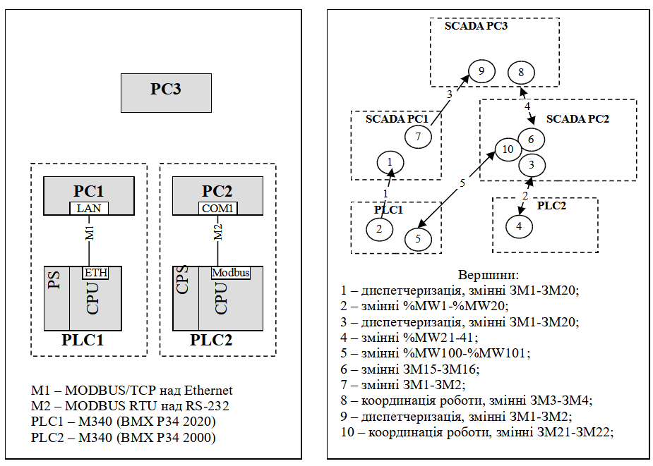

| PLC1            | PLC2            | SCADA PC1                    | SCADA PC2                                                    | SCADA PC3                                                    |
| --- | --- | ---- |  |  |
| не допускається | не допускається | OPC Client   MODBUS/TCP | OPC Client   OPC Server   MODBUS RTU  MODBUS/TCP | OPC Client   OPC Server   MODBUS RTU   MODBUS/TCP |

### Варіант №10

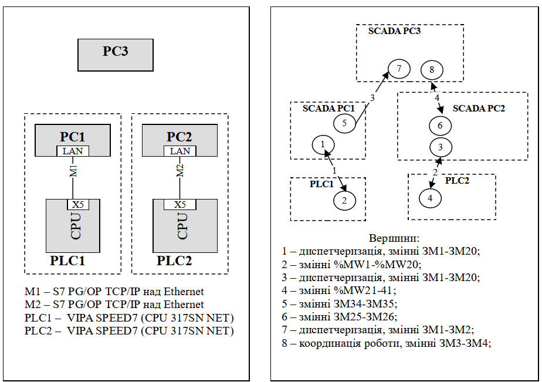

| PLC1            | PLC2            | SCADA PC1                                           | SCADA PC2                                          | SCADA PC3                                          |
| --- | --- | --- | -- | -- |
| не допускається | не допускається | OPC Client   OPC Server   S7 PG/OP TCP/IP | OPC Client   OPC Server  S7 PG/OP TCP/IP | OPC Client   OPC Server  S7 PG/OP TCP/IP |

### Варіант №11

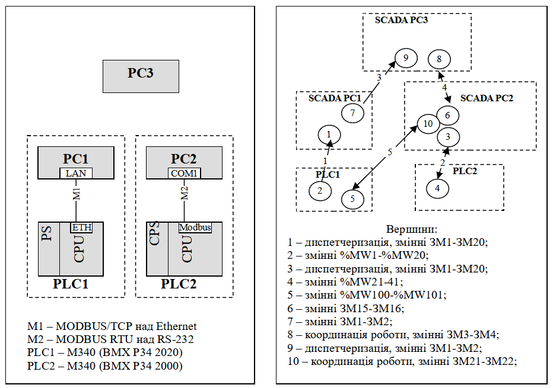

| PLC1            | PLC2            | SCADA PC1                                      | SCADA PC2                                      | SCADA PC3                                                    |
| --- | --- | ---- | ---- |  |
| не допускається | не допускається | OPC Client   OPC Server   MODBUS/TCP | OPC Client   OPC Server   MODBUS RTU | OPC Client   OPC Server   MODBUS RTU   MODBUS/TCP |

### Варіант №12

| PLC1            | PLC2            | SCADA PC1                                           | SCADA PC2                                                 | SCADA PC3                                                    |
| --- | --- | --- | --- |  |
| не допускається | не допускається | OPC Client   OPC Server   S7 PG/OP TCP/IP | OPC Client   OPC Server   MPI (S7 PG/OP Serial) | OPC Client   OPC Server   MPI (S7 PG/OP Serial)  S7 PG/OP TCP/IP |

### Варіант №13

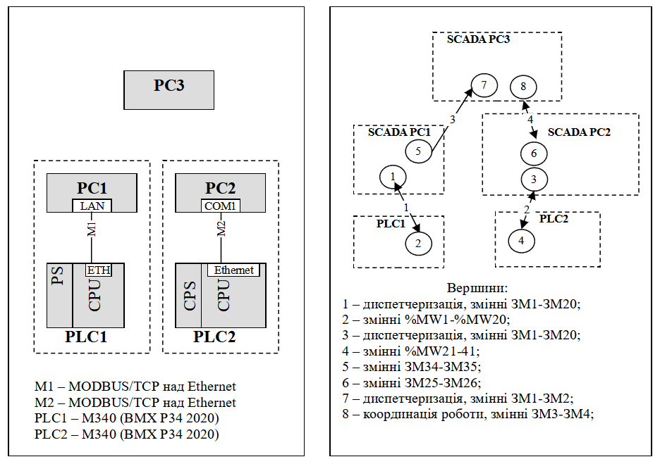

| PLC1            | PLC2            | SCADA PC1                                      | SCADA PC2                                     | SCADA PC3                                                    |
| --- | --- | ---- | --- |  |
| не допускається | не допускається | OPC Client   OPC Server   MODBUS/TCP | OPC Client   OPC Server  MODBUS/TCP | OPC Client   OPC Server   MODBUS RTU   MODBUS/TCP |

### Варіант №14

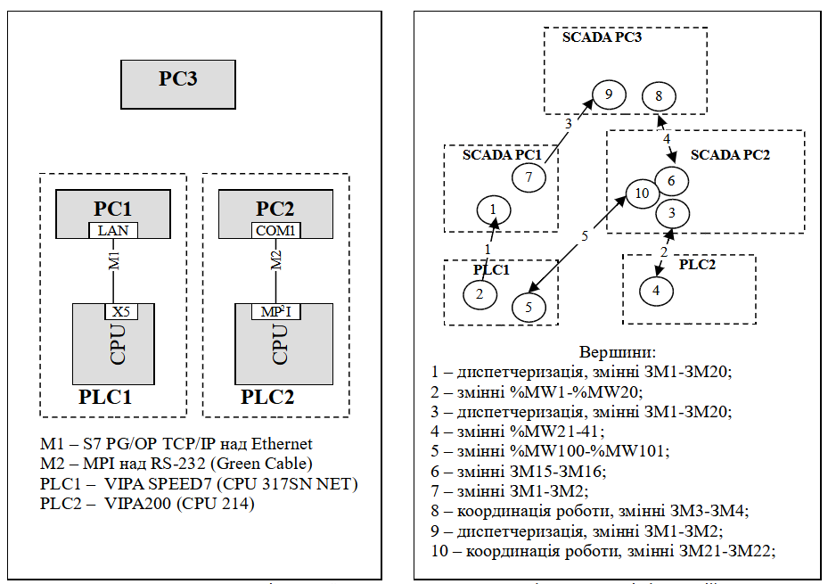

| PLC1            | PLC2            | SCADA PC1                         | SCADA PC2                                                    | SCADA PC3                                                    |
| --- | --- | --- |  |  |
| не допускається | не допускається | OPC Client   S7 PG/OP TCP/IP | OPC Client   OPC Server   MPI (S7 PG/OP Serial)  S7 PG/OP TCP/IP | OPC Client   OPC Server   MPI (S7 PG/OP Serial)  S7 PG/OP TCP/IP |

### Варіант №15

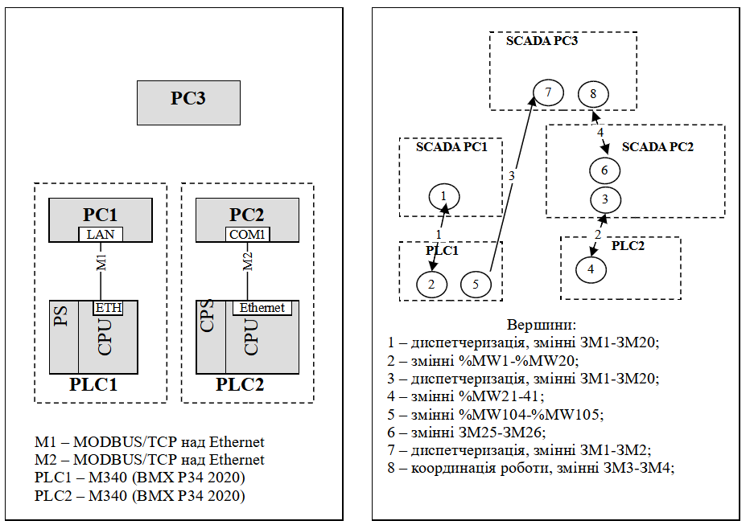

| PLC1            | PLC2            | SCADA PC1                                      | SCADA PC2                                     | SCADA PC3                                      |
| --- | --- | ---- | --- | ---- |
| не допускається | не допускається | OPC Client   OPC Server   MODBUS/TCP | OPC Client   OPC Server  MODBUS/TCP | OPC Client   OPC Server   MODBUS/TCP |

### Варіант №16

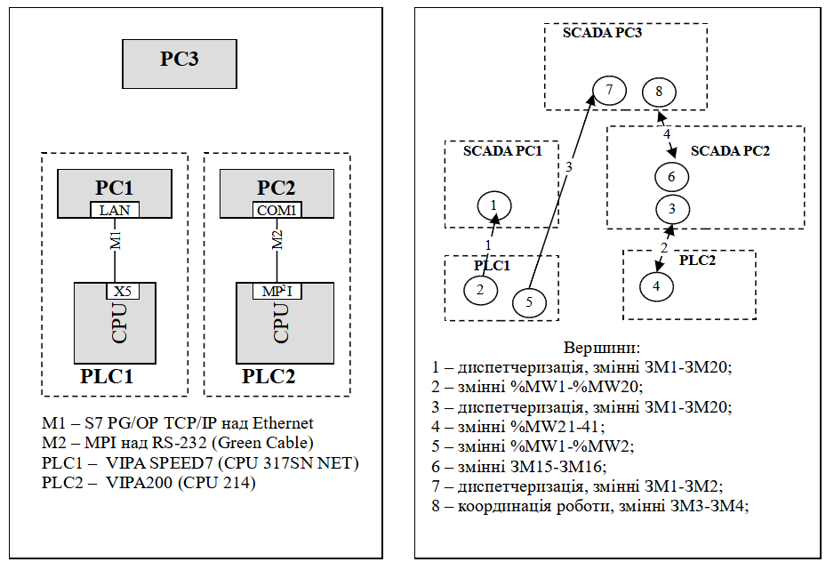

| PLC1            | PLC2            | SCADA PC1                                           | SCADA PC2                                                | SCADA PC3                    |
| --- | --- | --- | -- | ---- |
| не допускається | не допускається | OPC Client   OPC Server   S7 PG/OP TCP/IP | OPC Client   OPC Server  MPI (S7 PG/OP Serial) | OPC Client   OPC Server |

### Варіант №17

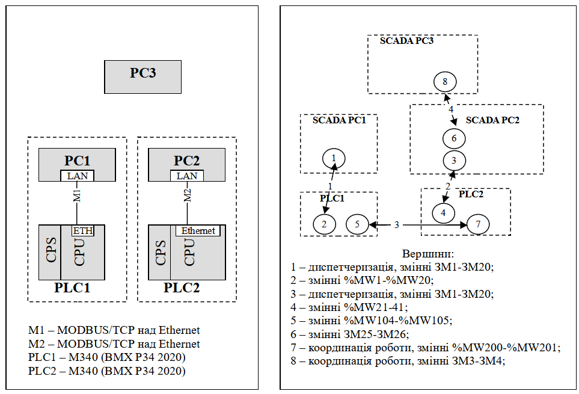

| PLC1            | PLC2            | SCADA PC1                                      | SCADA PC2                                     | SCADA PC3                                      |
| --- | --- | ---- | --- | ---- |
| не допускається | не допускається | OPC Client   OPC Server   MODBUS/TCP | OPC Client   OPC Server  MODBUS/TCP | OPC Client   OPC Server   MODBUS/TCP |

### Варіант №18

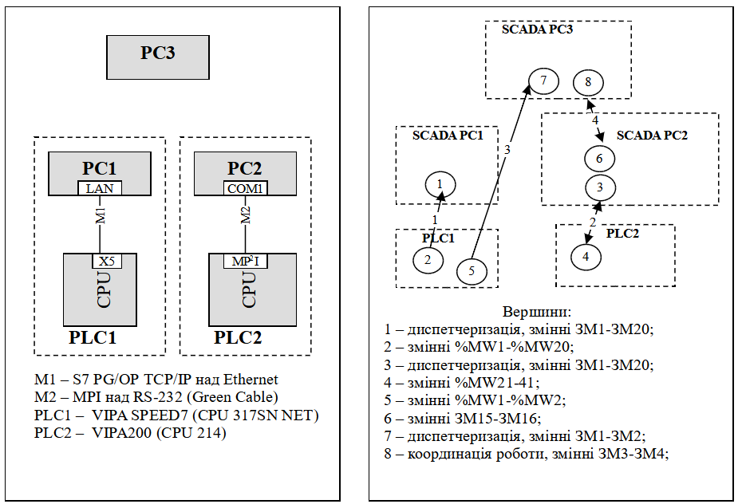

| PLC1            | PLC2            | SCADA PC1                         | SCADA PC2                                                | SCADA PC3                                                    |
| --- | --- | --- | -- |  |
| не допускається | не допускається | OPC Client   S7 PG/OP TCP/IP | OPC Client   OPC Server  MPI (S7 PG/OP Serial) | OPC Client   OPC Server   MPI (S7 PG/OP Serial)   S7 PG/OP TCP/IP |

### Варіант №19

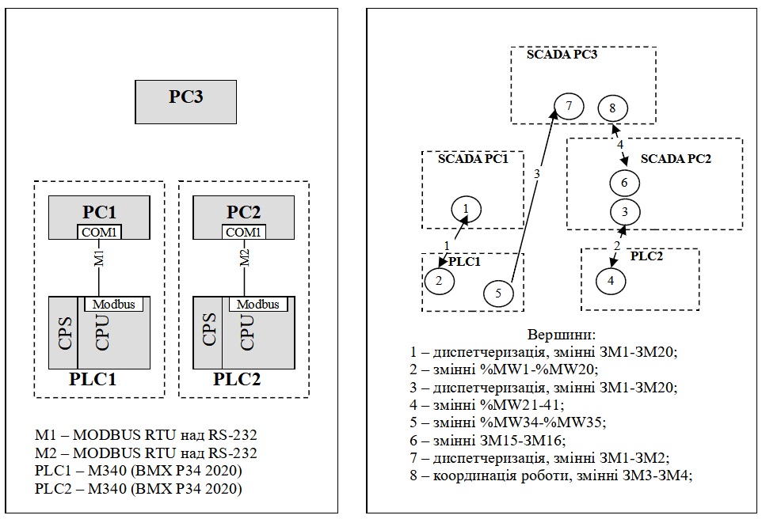

| PLC1                         | PLC2                         | SCADA PC1                    | SCADA PC2                                                    | SCADA PC3                                                    |
| ---- | ---- | ---- |  |  |
| допускаються вбудовані в CPU | допускаються вбудовані в CPU | MODBUS RTU   MODBUS/TCP | OPC Client   OPC Server   MODBUS RTU  MODBUS/TCP | OPC Client   OPC Server   MODBUS RTU   MODBUS/TCP |

### Варіант №20

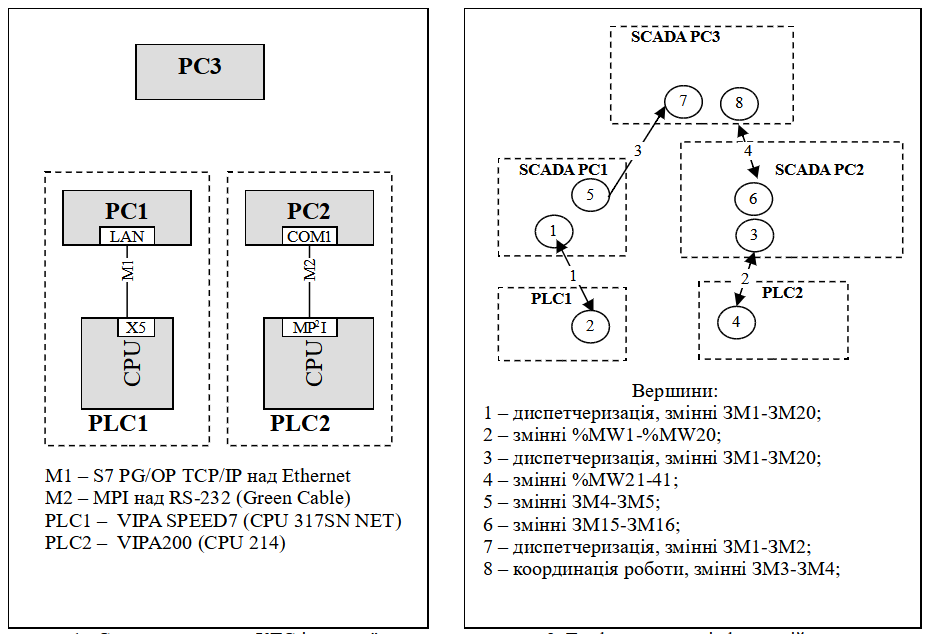

| PLC1            | PLC2            | SCADA PC1                                           | SCADA PC2                                                | SCADA PC3                                                    |
| --- | --- | --- | -- |  |
| не допускається | не допускається | OPC Client   OPC Server   S7 PG/OP TCP/IP | OPC Client   OPC Server  MPI (S7 PG/OP Serial) | OPC Client   OPC Server   MPI (S7 PG/OP Serial)   S7 PG/OP TCP/IP |

## Питання для самоконтролю знань

1. Яка модель обміну використовується в Modbus TCP?
2. Чим відрізняються ролі клієнта і сервера в Modbus TCP?
3. У чому перевага Modbus TCP порівняно з Modbus RTU?
4. Які пристрої найчастіше виступають як клієнти в мережі Modbus TCP?
5. Чи може один вузол бути одночасно і клієнтом, і сервером у Modbus TCP?
6. Які параметри обміну потрібно визначити при проєктуванні логіки запитів?
7. Що таке відображення (карта регістрів, Modbus Map) і для чого вона потрібна?
8. Які фактори впливають на трафік у мережі Modbus TCP?
9. Який стандартний порт використовує Modbus TCP?
10. Які типи регістрів існують у Modbus?
11. Які типи Modbus шлюзів існують за алгоритмом роботи?
12. У чому полягає принцип роботи прозорого шлюзу Modbus? Які обмеження має прозорий шлюз?
13. Яку роль виконує Unit ID у Modbus TCP ↔ RTU?
14. Що таке шлюз з адресним відображенням і яка його перевага?
15. Як забезпечити сумісність між пристроями з RTU і TCP інтерфейсами?
16. Які чинники впливають на затримку при використанні шлюзів?
17. У чому особливість реалізації клієнта Modbus TCP у SCADA?
18. Як реалізується відображення регістрів у різних пристроях?
19. У яких випадках варто вибирати OPC UA, а в яких OPC DA?