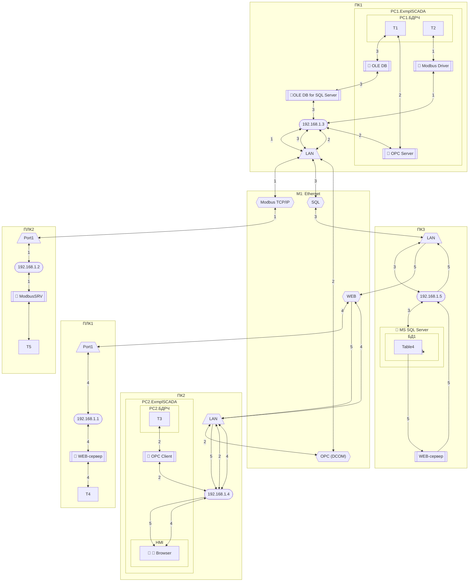

# Практичне заняття 5. Проектування міжпрограмних комунікацій

## Основні теоретичні відомості

### Інформаційна структура

Проектування міжпрограмних комунікацій потребує розроблення інформаційної структури. Розроблення інформаційної структури в контексті комп’ютерно-інтегрованих систем керування (КІСК) полягає у формуванні моделі потоків даних, форматів, структур тегів, інтерфейсів обміну між компонентами системи, а також опису інформаційної взаємодії між підсистемами.

Це включає:

1. Модель тегів та змінних: опис усіх змінних (тегів), які використовуються в системі, включно з: назвою, типом, одиницями, джерелом (PLC, SCADA, OPC тощо), частотою оновлення.
2. Інформаційна архітектура (Information Architecture): опис структури даних і їхнього руху між підсистемами, зокрема: таблиці змінних; OPC UA Nodeset (якщо використовується); відповідність між базами даних, SCADA, PLC; формати повідомлень, структури пакетів.
3. Інтерфейси та протоколи обміну: формування специфікацій на інтерфейси між підсистемами; вибір протоколів обміну (Modbus, OPC UA, MQTT тощо); мапування тегів між вузлами.
4. Правила доступу та управління даними: визначення прав на читання/запис; політики журналювання; безпечний обмін даними (особливо згідно IEC 62443).
5. Трасування даних: зв’язки між тегами і вимогами користувача; контроль відповідності даних у контексті перевірки (V&V).

Цей опис є частиною інформаційного подання архітектури системи згідно ISO/IEC/IEEE 42010 і повинен бути узгоджений з іншими поданнями (технологічним, фізичним, функціональним тощо)

Основне завдання схеми показати реалізацію інформаційної взаємодії між даними мережних вузлів. Схеми та таблиці, які відображають інформаційну структуру, можна розробляти окремо для кожної із мереж або для всієї системи. 

На схемі інформаційної структури необхідно графічно зобразити масиви даних в базах даних вузлів системи, та їх взаємозв’язок інформаційними потоками. Наочність дає змогу краще розуміти процеси обміну, які діють в системі, тому бажано особливо не нагнітати схему надлишковою інформацією. Для побудови такої схеми, проектант повинен розуміти основні принципи роботи мережного обладнання, протоколів обміну, програмного забезпечення вузлів і т.д.

Основними елементами схеми є:

1. масиви даних процесу, які приймають участь в загальносистемному обміні, тобто які циркулюють по обчислювальним мережам;

2. інформаційні потоки, які забезпечують доставку даних з бази даних джерела в базу даних отримувачів; 

3. мережні сервіси/протоколи, за допомогою яких реалізовані інформаційні потоки;

4. комунікаційні логічні канали пристроїв та програмного забезпечення, через які проходять інформаційні потоки: драйвер, логічний канал, адреса, тощо; 

5. уточнюючі характеристики інформаційних потоків: в графічній частині бажано показати хто ініціював запит (Клієнт, Видавець або Виробник) та напрямок передачі інформації; в текстовій – всю іншу інформацію, відповідно до вимог до інформаційного забезпечення.

Для створення та представлення інформаційної архітектури комп’ютерно-інтегрованих систем керування (КІСК) використовуються різні формати, моделі подання та інструменти, залежно від цілей (проєктування, інтеграції, документування, валідації, сертифікації). Зокрема можна виділити:

- Табличні (Spreadsheet/CSV): Таблиці тегів (I/O list), Таблиці зв’язків між змінними та джерелами/споживачами, Таблиці трасування (traceability matrix). 
- Електронні документи XML/JSON/B2MML/AutomationML: Для експорту/обміну між системами (особливо OPC UA, MES, ERP), B2MML – XML-представлення моделей ISA-95, AutomationML – інтеграція між CAD/CAE/PDM/SCADA/PLC, EPLAN XML, TIA Portal XML, Step7-SCL – для імпорту/експорту конфігурацій
- графічні подання: ERD (Entity Relationship Diagram) або UML Class Diagram - для логічного моделювання даних,  EPC / BPMN / IDEF0 + DFD - Для опису потоків інформації у процесах.

### Інформаційна структура в Mermaid

Інформаційну структуру можна виконувати в Mermaid. Для цього пропонується дотримуватися узгодженого набору умовних позначень для всіх типів об'єктів, які беруть участь в обміні, а також структури схеми, яка відображає логіку послідовного слідування потоку від ресурсу-джерела до ресурсу-приймача через відповідні програмні засоби, порти, адреси, сервіси та мережі. Нижче наведений приклад виконання схеми інформаційних потоків з означеними правилами подання.

Кожен елемент у схемі повинен мати відповідну форму відображення, яка дозволяє без додаткових пояснень ідентифікувати його тип та роль. Інформаційні потоки позначаються спрямованими стрілками з унікальними ідентифікаторами, що дозволяє виконувати трасування в документації та описах. Потоки починаються з ресурсів, які позначаються прямокутниками, і проходять через проміжні об'єкти, які наведені в таблиці 5.1.:

Таблиця 5.1. Приклад позначення сутностей на схемах інформаційних потоків виконаних в Mermaid

| Сутність                               | Призначення                                         | Mermaid-позначення                                    | Приклад                                                    |
| -------------------------------------- | --------------------------------------------------- | ----------------------------------------------------- | ---------------------------------------------------------- |
| Ресурс                                 | Точка початку або завершення потоку                 | `["..."]` - прямокутник                               | `["DB10.DBW6 Level"]`                                      |
| Контейнер                              | Обчислювальний пристрій або ПЗ                      | `subgraph` - виділена область                         | `subgraph PLC1 [...]`                                      |
| Вкладений контейнер                    | Підсистема або програмний модуль усередині іншого   | `subgraph` - виділена область                         | `subgraph SCADA [...]`                                     |
| Програма (драйвер, служба, застосунок) | Активний компонент, що реалізує або викликає сервіс | `[[...]]` - прямокутник з подвійними боковими рамками | `[[🔷 Modbus Driver]]`, `[[🔳 HMI App]]`, `[[🔴 OPC Server]]` |
| Порт / логічний канал                  | Інтерфейс пристрою                                  | `[/...\]` - трапеція                                  | `[/Port1\]`                                                |
| Адреса                                 | Адресація вузла, модуля або інтерфейсу              | `([...])` - овал                                      | `([192.168.0.1:502])`                                      |
| Сервіс (протокол)                      | Прикладний протокол або інтерфейс в мережі          | `{{...}}` - вузол типу `subroutine`                   | `{{MQTT}}`                                                 |
| Мережа з інформаційною шиною           | Середовище передачі даних між вузлами               | `subgraph` - виділена область                         | `subgraph Net1 [...]`                                      |
| Інформаційний потік                    | Послідовність обміну між ресурсами                  | `--> |n|` - лінія зі стрілками                        | `--> |1|`                                                  |

Контейнери представляють логічну або фізичну структуру, в якій розміщено ресурси або програми: наприклад, обчислювальний пристрій, прикладна програма або середовище виконання. Вони оформлюються як `subgraph` у Mermaid, з можливістю вкладеності. Для наочності ролі програм при доступі до ресурсів можуть позначатися кольоровими emoji-символами, які наведені в таблиці 5.2. Ролі вказуються в програмах, не на стрілках або сервісах.

Таблиця 5.2. Позначення ролей програм в обміні

| Роль                                  | Позначення | Unicode | Значення                    |
| ------------------------------------- | ---------- | ------- | --------------------------- |
| Сервер                                | 🔴          | U+1F534 | Приймає запити, відповідає  |
| Клієнт                                | 🔷          | U+1F537 | Ініціює запити              |
| Видавець                              | 🔺          | U+1F53A | Публікує дані (MQTT, події) |
| Підписник                             | 🟩          | U+1F7E9 | Отримує дані                |
| Наявність людино-машинного інтерфейсу | 🔳          | U+1F533 | Взаємодіє з користувачем    |

Цей підхід дозволяє створювати масштабовані, однозначно читабельні та формально узгоджені схеми, придатні як для візуального аналізу архітектури обміну, так і для автоматизованої документації.

Приклад схеми зробленої в Mermaid показаний на рис.5.1.

рис.5.1. Приклад схеми інформаційних потоків в Mermaid

### Виконання схем в Mermaid

Схеми Mermaid добре імплементуються в MarkDown, їх підтримує в тому числі GitHub. Для виконання практичних робіт пропонується онлайн-редактор  https://mermaid.live. Цей редактор: 

- дозволяє створювати, переглядати та експортувати діаграми Mermaid у браузері без встановлення додаткового ПЗ;
- підтримує попередній перегляд у реальному часі, що зручно при відлагодженні схеми;
- забезпечує можливість зберігати та завантажувати код діаграм;
- підходить для копіювання як у форматі зображення (PNG/SVG), так і у вигляді коду для вставки у Markdown-документацію;
- має приклади типових діаграм (flowchart, sequence, state, class, entity-relationship тощо) — зручно для ознайомлення;
- підтримує стилізацію елементів, угрупування, умовні блоки, стрілки з підписами — усе необхідне для побудови інформаційних схем у КІСК.
- зареєстрована версія дає можливість використовувати візуальний конструктор

Рекомендується для використання здобувачами під час виконання практичних робіт з побудови схем інформаційної структури системи, особливо при документуванні інформаційних потоків і взаємодії програмних компонентів а також виконання курсового проєкту. 

## Завдання для самостійної роботи

1. Перейдіть на https://mermaid.live, зареєструйтеся.
2. Виконайте в Mermaid графову модель інформаційних потоків, наведену у практичному занятті 4 відповідно до Вашого варіанту.
3. Виконайте в Mermaid схему інформаційних потоків, зроблену у практичному занятті 4 відповідно до Вашого варіанту.
4. Виконайте та збережіть в Mermaid модель інформаційних потоків та схему інформаційних потоків ваших схем з курсового проєкту.

## Питання для самоконтролю знань

1. Що включає в себе поняття «інформаційна структура» у КІСК?
2. Що таке модель тегів і змінних?
3. Яку інформацію необхідно вказати для кожного тегу?
4. Що таке інформаційна архітектура?
5. Які можна використовувати формати представлення інформаційної архітектури?
6. Яке місце інформаційна структура займає у загальній архітектурі системи?
7. Які елементи обов’язково повинні бути на схемі інформаційної структури?
8. Що таке ресурси?
9. Яку роль відіграють інформаційні потоки у схемі?
10. Що відображає мережний сервіс у схемі?
11. Які особливості побудови логічного каналу між пристроями?
12. Як у схемі відображаються ініціатор запиту та напрямок передачі даних?
13. Які основні формати для створення документації інформаційної структури?
14. Як застосовується Mermaid для побудови схем інформаційних потоків?
15. Яке Mermaid-позначення використовується для ресурсу?
16. Як позначається програма в Mermaid-схемі?
17. Яким чином реалізується вкладення контейнерів у Mermaid?
18. Які сервіси мають бути відображені у схемі інформаційної структури?
19. Як показати обмін між SCADA та SQL-сервером у схемі?
20. Чим відрізняється інформаційна структура від фізичної топології мережі?
21. Яке значення має унікальний ідентифікатор потоку у Mermaid?
22. Для чого потрібне трасування у документації інформаційних потоків?