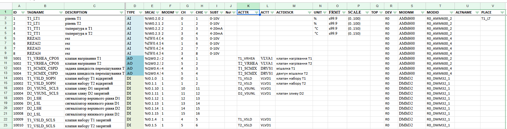

# Практичне заняття 8. Підготовка проектних даних для подальшої автоматизації розгортання

## Основні теоретичні відомості

### Використання табличних інструментів при проєктуванні

Табличні інструменти, зокрема електронні таблиці (Microsoft Excel, LibreOffice Calc, Google Sheets), відіграють важливу роль на всіх етапах проєктування комп’ютерно-інтегрованих систем керування. Вони забезпечують зручний спосіб структурування, аналізу, трансформації та передачі проєктних даних між різними учасниками проєкту, а також між різними програмними середовищами.

У процесі проєктування табличні інструменти використовуються для:

- ведення переліку змінних (тегів) системи, з вказанням їхніх ідентифікаторів, адрес, типів даних, одиниць вимірювання, джерел, напрямків обміну, доступності для архівації, візуалізації, логування тощо;

- формування специфікацій обладнання, в яких зазначається найменування пристроїв, моделі, конфігурація, кількість каналів, інтерфейси, тип живлення, тип корпусу, клас захисту;

- побудови таблиць прив’язки сигналів до модулів вводу-виводу, портів, клем, кабелів, які є основою для формування схем з’єднань та монтажних відомостей;

- відображення структури програмних блоків, параметрів рецептур, таблиць станів автоматів, режимів роботи обладнання;

- ведення таблиць трасування сигналів та інформаційних потоків між вузлами системи, у тому числі з вказанням сервісів і протоколів, які використовуються для обміну.

Окрім цього, табличні форми можуть використовуватися як проміжний формат для обміну даними між системами САПР, середовищами розроблення ПЛК, SCADA та MES. Багато середовищ підтримують імпорт/експорт у форматі CSV або XML, що дозволяє автоматизувати створення конфігурацій на основі підготовлених таблиць. Це значно знижує ймовірність помилок, зменшує час розроблення, а також забезпечує повторне використання шаблонів і типових структур.

У навчальних і курсових проєктах використання табличних засобів є доцільним для опису інформаційної структури, складання структурних і функціональних специфікацій, формування відомостей про обладнання, а також як інтерфейс для формалізації технічних рішень перед побудовою схем.

У якості можливого табличного інструменту можна використовувати Google Sheets. Хоча Google Sheets зазвичай використовується як зручний онлайн-табличний редактор, його можливості спільної роботи роблять цей інструмент надзвичайно ефективним і для проєктування систем керування. Наведемо  деякі можливості Google Sheets у контексті проєктування систем керування:

1. Спільна робота над даними:
   - одночасне редагування кількома користувачами;
   - коментарі та обговорення в контексті конкретних клітинок;
   - контроль доступу (редагування, перегляд, коментування).
2. Автоматичне збереження та журнал змін:
   - автоматичне збереження кожної дії;
   - історія версій з можливістю відновлення.
3. Формалізація проєктних даних:
   - ведення переліку тегів, сигналів, пристроїв, портів тощо;
   - підтримка зв’язків між даними через формули, посилання, аркуші.
4. Спільне введення конфігурацій:
   - паралельне заповнення таблиць SCADA, PLC, мережевої адресації;
   - уникнення дублювання та помилок завдяки єдиному джерелу правди.
5. Експорт та інтеграція:
   - експорт у CSV, XLSX, ODS, PDF;
   - використання CSV для імпорту у SCADA, PLC IDE, EPLAN.
6. Імпорт даних з інших джерел:
   - з OPC, MES, PLM, JSON/XML-структур у таблиці для перегляду й обробки.
7. Автоматизація та інтеграція:
   - Google Apps Script для автоматизації;
   - надбудови для обміну даними;
   - генерація конфігураційних файлів (JSON, XML, Nodeset).
8. Роль сховища майстерданих:
   - використання як централізованої бази для об'єктів, змінних, інтерфейсів;
   - можливість створення референсного джерела для всієї команди.
9. Підтримка інженерного проєктування:
   - валідація, умовне форматування, захист даних;
   - використання як прототипу для URS/FRS згідно з ISA-5.6.
10. Придатність до машинної обробки:

- формат даних зручний для аналізу, трансформації, генерації документації.

### Майстердані

Майстердані (master data) — це набір еталонної інформації, яка описує сутності, що є спільними для багатьох процесів та систем: обладнання, змінні, продукти, рецепти, користувачі, виробничі одиниці, маршрути, клієнти тощо. Майстердані не є транзакційними, тобто не відображають події, а є довідковою базою для транзакцій і конфігурації. Призначення майстерданих у КІСК:

1. Єдине джерело правди — слугують референсною інформацією, яка використовується всіма підсистемами (SCADA, PLC, MES, ERP).
2. Уніфікація даних — забезпечують узгодженість ідентифікаторів, назв, форматів даних між різними системами.
3. Підґрунтя для конфігурації — використовуються для автоматичного формування:
   - таблиць тегів;
   - конфігурацій мереж;
   - структури рецептів;
   - карт зв’язків у OPC UA, MQTT, REST API.
4. Забезпечення повторного використання — дозволяють формувати шаблони конфігурації для типових об'єктів або пристроїв.
5. Спрощення інтеграції — полегшують зв’язок між інженерними, інформаційними та виробничими рівнями системи.
6. Підтримка цифрових двійників — виступають основою для інформаційних моделей активів і процесів.

В межах прийнятих рекомендацій в межах цього курсу пропонуються такі частини майстерданих:

- таблиця тегів - містить устатковання CM нижнього рівня, кожен з яких є тегом, з усією необхідною інформацією, стосовно нього
- таблиця класів устатковання - містить перелік класів устатковання з усією необхідною інформацією
- таблиця устатковання - містить перелік устатковання з посиланням на класи з усією необхідною інформацією 

Означення майстерданих може починатися з різних частин в залежності від прийнятих практик проєктування. Якщо на ранніх етапах відбувається декомпозиція устатковання, то першими заповнюються таблиці з устаткованням та класами. Якщо проєкт розробляється з технології і вихідною є схема автоматизації (P&ID) і проєктант може отримати список тегів, тоді спочатку заповнюється таблиця тегів.   

### Найменування сутностей

Означення майстерданих варто почати з означення правил найменування сутностей, якщо це не було зроблено раніше. Рекомендації щодо ідентифікації устатковання були розглянуті в попередніх практичних заняттях. Тут наведемо частину лекційного матеріалу щодо ідентифікації тегів.  

Під поняттям **Тег (Tag)** або **технологічна змінна**  часто розуміють іменовану технологічну змінну, яка описує фізичну або логічну величину, що використовується у системі автоматизованого керування. Теги є основою для зв’язку між схемою автоматизації, програмою ПЛК та системами SCADA/HMI. У загальному випадку тег:

- має ім’я, яке використовується в програмному середовищі (наприклад, `TIC101_PV`);
- відповідає сигналу на вході або виході ПЛК (реальному чи внутрішньому);
- пов’язаний із елементом на схемі автоматизації (P&ID) — приладом, виконавчим механізмом, контролером або функцією;
- фігурує у базі даних тегів SCADA, що використовується для візуалізації, архівування, сигналізації.

Схема автоматизації (P&ID) задає функціональну структуру системи та позначає контури керування згідно з ISA 5.1 або ГОСТ 21.408 (наприклад, `TIC101`, `LT202`). Тег зв’язує логічне ім’я зі схемою (через позначення функції) та з ПЛК (через карту адресації). У SCADA/HMI тег зберігає значення сигналу, використовується у графіці, тривогах, логіці подій. Таким чином тег має наскрізний характер, якщо забезпечувати правила його найменування у всіх частинах проекту. Наприклад, якщо на схемі автоматизації `TIC101` — регулятор температури, а у ПЛК вхід `AI0.1` зчитує температуру з датчика, то можна вважати його  `TIC101_PV` або `TT101` (позначення датчика температури). У першому варіанті беруть за основу контур, а в другому - позначення засобу вимірювання або керування, які підключені до ПЛК.

Структурована система тегів забезпечує простежуваність між елементами схеми, програмним кодом і операторським інтерфейсом. Якщо взяти за основу концепцію рольової ієрархії, то теги є відображенням сигналів з устатковання нижнього рівня ієрархії - Control Module (ISA-88) або Device (ISA-106), а отже є сенс робити ієрархічне найменування. Наприклад назву тегів можна давати в трирівневому варіанті:

```
UNIT_INSTRUMENT_SIGNAL
```

- `UNIT` - назва установки, місця, одиниці устатковання, потрібна для ідентифікації засобів автоматизації в різних групах устатковання. Хоч назви цього устатковання можуть мати свої префікси, не варто її використовувати, якщо це не вимушена міра для унікальної ідентифікації.  
- `INSTRUMENT` - ідентифікація засобів автоматизації відповідно до схеми автоматизації або P&ID (надалі P&ID). Якщо P&ID передбачає ієрархічне найменування, перша частина (префікс) може стати в позицію `UNIT`, друга (починаючи з функціональної літери) стає на позицію `INSTRUMENT`. Замість числових позначень контуру P&ID можна використовувати альтернативні символи контуру. Правила ідентифікації засобів на діаграмах часто беруться з прийнятих в технології, рекомендується використовувати саме ті ідентифікатори, які використані в схемах P&ID.  
- `SIGNAL` - уточнююча інформація про сигнал, так як один і той самий засіб автоматизації на схемі P&ID, може мати кілька входів/виходів. Може бути опущений, якщо засіб має тільки один сигнал зв'язку з ПЛК.       

Ось кілька прикладів:

```
T101_TT1 - температура TT1 в танку T101
T101_TT1_PV - температура TT1 в танку T101 (альтернативний варіант)
UN_T101_TT1_PV - температура TT1 в танку T101 (альтернативний варіант 2 з префіксом уточнення рівня устатковання танку)
T101_LS1 - сигналізатор рівня
T101_LSH - сигналізатор рівня (альтернативний варіант)
T101_TV1_CPOS - вихід на керування клапаном TV1
T101_TV1_POS - плинна позиція клапану TV1
```

Варто означити також правила для найменування суфіксів, які означують сигнал, що дозволить легко робити навігацію в тегах. Нижче наведені рекомендації, які можна прийняти за основу. 

Усі суфікси для вихідних сигналів повинні починатися з літери `C`, вхідні сигнали не повинні починатися з літери  `C`

**Дискретні вхідні сигнали**

- `ALM` - стан Аварія, наприклад `T101_TY1_ALM` - сигнал аварії перетворювача частоти
- `LSTP` - натиснута кнопка "Місцевий стоп"
- `PWR` - наявність живлення схеми керування
- `RDY` - готовність пристрою до роботи
- `RMT` - стан перемикача місцевий/дистанційний
- `RUN` - двигун в роботі (наприклад вал двигуна обертається)
- `SCLS`  - положення закрито
- `SOPN` - положення відкрито
- `SPDC` - контакт дискретного датчику контролю обертів (наприклад індуктивний контакт)
- `WRN` - стан попередження
- `WRK` - пристрій в роботі (альтернатива `RUN`)

**Аналогові вхідні сигнали**

- `ECUR` - струм двигуна

- `POS` - положення РО

- `PV`  - плинне значення (вказується тільки при кількох сигналах з пристрою)

- `SPD` - Дійсна швидкість/частота

**Дискретні вихідні сигнали**

- `CBWR` - рух назад (керування переміщенням) 
- `CCLS` - керування закрити
- `CFRW` - рух вперед (керування переміщенням)
- `COPN` - керування відкрити або відкрити/закрити
- `CRMT` - включення/відключення дистанційного керування
- `CRVRS` - Керування Реверс, або Реверс/Стоп
- `CSTRT` - Керування Пуск, або Пуск/Стоп
- `CSTP` - Керування Стоп
- `CUP` - команда Більше (можна використовувати COPN)
- `CDN` - команда Менше (можна використовувати CCLS)
- `CBLK` - команда на дистанційне блокування
- `CCLR` - команда скидання тривог  

**Аналогові вихідні сигнали**

- `CSPD` - задана швидкість/частота

- `CPOS` - задана позиція ВМ


### Приклад означення майстерданих

Приклад майстерданих в Google Sheet наведений [за посиланням](https://docs.google.com/spreadsheets/d/1GvttNOH74X2o9y0fh_qxQCHhfdFszx7m/edit).

Перед означенням таблиці-аркуша тегів можна спочатку сформувати таблицю-аркуш з устаткованням з зазначенням класу, перелік і означення яких розроблено раніше. Перелік можна надати у вигляді окремого аркуша електронної таблиці, де будуть міститися усі майстердані, туди ж варто помістити і означені раніше класи. Для кожного утсатковання необхідно вказати:

- символьне позначення устаткування
- назву
- тип
- посилання на означення типу (наприклад на лист електронної таблиці)
- примітки
- розміщення
- інша інформація, наприклад ідентифікатор активу, який виконує цю роль, посилання на необхідну документацію, та інша проектна інформація

Надалі по тексту тег і змінна є синонімами. 

На аркуші таблиці з тегами для кожного тегу варто вказувати:	

- `TAGNAME` - унікальний ідентифікатор тегу відповідно до прийнятих правил ідентифікації 

- `DESCRIPTION` - опис тегу 

- `TYPE` - тип (клас) тегу. Тут варто використовувати умовні позначення, перелік яких надається в описі до таблиці, наприклад 

  - `AI` - AIVAR

  - `DI` - DIVAR

  - `AO` - AOVAR

  - `DO` - DOVAR

  - `NAI` - Network AIVAR (підклас)

  - `NAO` - Network AOVAR (підклас)

  - `NDI` - Network DIVAR (підклас)

  - `NDO` - Network DOVAR (підклас)	


- `UNIT` (не обов'язкове) - інженерні одиниці, може бути використаним при наступному розгортанні в SCADA/HMI (див відповідний розділ)

- `FRMT` (не обов'язкове) - формат відображення, може бути використаним при наступному розгортанні в SCADA/HMI (див відповідний розділ)		

- `SCALE` (не обов'язкове) - налаштування масштабування для аналогових величин; якщо заповнюється, то задається у форматі `(min..max)` , наприклад `(0..100)`. Виставляється у відповідних полях змінних ПЛК за замовченням.	

- `ALTNAME` (не обов'язкове) - альтернативне позначення технологічної змінної, наприклад яке використовується в інших схемах, наприклад в принципових або схемі автоматизації    

- `SRCADR` - адреса змінної каналу в ПЛК. Дана адреса задається в тому форматі, який потрібен для ПЛК.

- `MODNMB` - номер модулю в пристроях, острову або шасі, де знаходиться канал. В

- `CH` - номер каналу в модулі, відповідно до нумерації модуля. 

- `SUBTYPE` (не обов'язкове) - підтип каналу, наприклад `4-20mA`

- `DEV` - назва пристрою або острову або шасі, де знаходиться модуль з каналом. 

- `MODNM`  - символьне ім'я модуля на пристрої шасі або острові 

- `MODID` - повна символьна назва модуля в системі, може формуватися за назвою `DEV` + `MODNM` + `MODNMB`  

- `ACTTR` - назва ВМ або іншого комплексного засобу, в якому використовується змінна. Вказуються в тому випадку, якщо технологічна змінна є частиною ВМ (ACT). У цьому випадку, вона буде використовуватися при генеруванні структур та коду для ВМ.  

- `ACTTYPE` - назва типу ВМ або іншого комплексного засобу, в якому використовується змінна. 
- `ACTDESCR` - опис ВМ



Рис.8.1 Приклад зовнішнього вигляду таблиці з майстерданими

## Завдання для самостійної роботи

1. Завантажте приклад майстерданих в Google Sheet, що наведений [за посиланням](https://docs.google.com/spreadsheets/d/1GvttNOH74X2o9y0fh_qxQCHhfdFszx7m/edit). Скопіюйте його на Google Drive в своєму аккаунті. Підключіть до цього документу аккаунт викладача.
2. Створіть таблицю з типами устатковання, що були розроблені на минулих заняттях.
3. Створіть таблицю з устаткованням, що були розроблені на минулих заняттях.
4. Сформуйте правила найменування тегів.
5. На основі схеми автоматизації або технологічної схеми з курсового проєкту вашого варіанту створіть таблицю з тегами. 

## Питання для самоконтролю знань

1. Які завдання вирішують табличні інструменти на етапі проєктування КІСК?
2. Які типи даних і структур формуються за допомогою електронних таблиць у проєктних роботах?
3. У чому полягають переваги використання Google Sheets для проєктування систем керування?
4. Які формати експорту підтримує Google Sheets і як це можна використати в контексті SCADA/PLC?
5. Як Google Sheets може бути інтегрованим в автоматизовані процеси конфігурації?
6. Що таке майстердані і чим вони відрізняються від транзакційних даних?
7. Яке призначення майстерданих у комп’ютерно-інтегрованих системах керування?
8. Які основні категорії об'єктів описуються через майстердані?
9. Як майстердані забезпечують уніфікацію і повторне використання проєктних даних?
10. Які таблиці зазвичай включаються до складу майстерданих?
11. У чому полягає різниця між таблицею тегів і таблицею устатковання?
12. Як формується таблиця класів устатковання і для чого вона потрібна?
13. Які підходи до означення майстерданих залежать від вихідної інформації: схеми P&ID чи структури устатковання?
14. Що таке тег у контексті автоматизації та яке його призначення?
15. Якою має бути структура імені тегу для забезпечення його наскрізного використання?
16. Які суфікси можна використовувати для дискретних вхідних сигналів?
17. Які суфікси можна використати аналогові вхідні сигнали?
18. Які суфікси можна використати для дискретних вихідних сигналів?
19. Які типи тегів виділяються за класами (AI, DI, AO, DO) та підтипами (NAI, NDO тощо)?
20. Які додаткові поля можуть містити таблиці тегів окрім `TAGNAME`, `TYPE` і `DESCRIPTION`?
21. Як у таблиці тегів описуються параметри масштабування і формат відображення?
22. Як відображається розміщення змінної у фізичному обладнанні в таблиці тегів?
23. Для чого у таблицях тегів вказується поле `ACTTR` та як воно використовується?
24. Які поля описують модуль, пристрій і канал у таблицях тегів?
25. Як організовується структура майстерданих у Google Sheets?
26. Як пов’язується тег з фізичним адресом у ПЛК?
27. Як таблиці майстерданих використовуються для автоматизованої генерації конфігурацій OPC UA або SCADA?